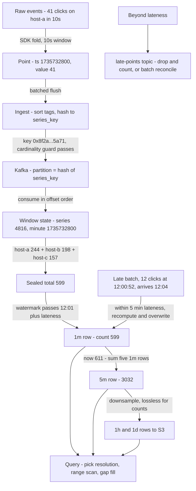
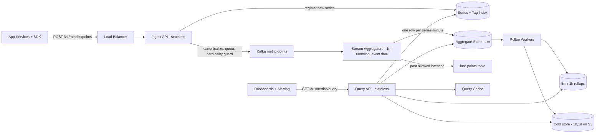
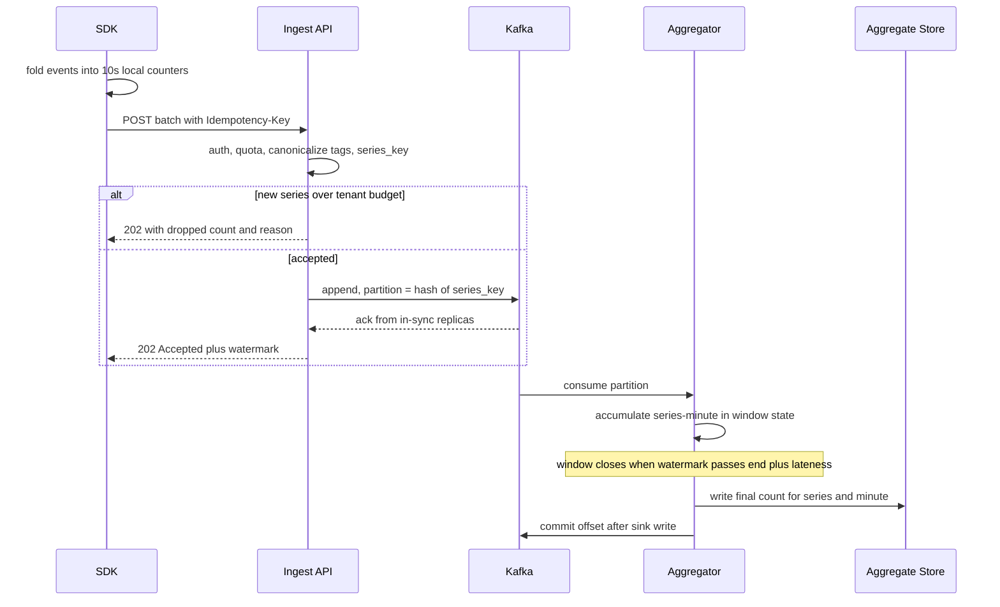
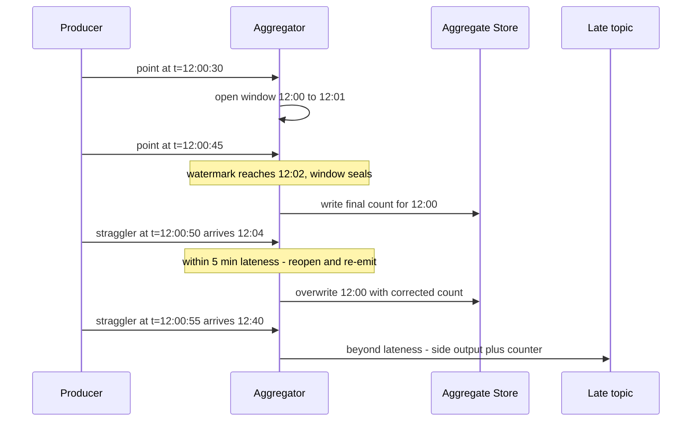
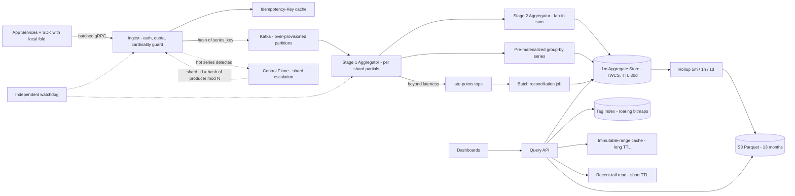

# Design a Count-Based Metrics Monitoring System
**Stripe — Senior SWE system design | 45 min**

---

## The thesis (thread this through every section)

> **Counts are a monoid — commutative, associative, idempotent under replacement. So fold them as early and as often as possible: in the client SDK, in the stream window, in the rollup job. Each fold buys headroom the next layer doesn't have to pay for.**
>
> **And once you fold aggressively, event volume stops being the scaling limit — series cardinality becomes it. Cardinality is a budget you govern, not a number you absorb.**

Say this out loud in minute 2 and refer back to it four times. It is the single thing that separates "I've read the Alex Xu chapter" from "I've operated one of these."

---

## 60-second opening script

> "So this is a push-based metrics pipeline with a fixed aggregation model — counts only, which is nice because counts are perfectly composable, so downsampling is lossless and I can pre-aggregate anywhere.
>
> I'll split the write path from the read path with a durable log in between, aggregate into 1-minute buckets in the stream layer, and store one immutable row per (series, minute). The two hard parts aren't throughput — they're **cardinality governance** and **event-time correctness**, so I'd like to spend most of the deep dives there.
>
> Before I draw: can I confirm five numbers with you — ingest rate, series cardinality, freshness SLO, query latency SLO, and retention? And one semantic question: do counts need to be **exact**, or is bounded approximation acceptable?"

That last question is the Stripe question. Get the answer before you design anything.

---

## Time budget

| Section | Minutes | Notes |
|---|---|---|
| Requirements + clarifications | 5 | Commit to assumptions fast |
| Core entities | 2 | Series is the star |
| API | 5 | Stripe grades API design harder than most |
| Data flow | 3 | It's a pipeline — do the ordered list |
| High-level design + diagram | 12 | Draw the whole thing |
| Deep dives | 15 | Cardinality, hot series, exactly-once, lateness, query fanout |
| Wrap / questions | 3 | |

---

# 1. Requirements

## Clarifying questions to ask (pick 5, then commit)

1. **Scale** — peak events/sec, number of active series, queries/sec?
2. **Exactness** — are these operational metrics (approximate OK) or money-adjacent counts (exact required)? *This flips the entire duplicate-handling design.*
3. **Freshness SLO** — how stale can a dashboard be? 10s, 1 min, 5 min?
4. **Tag cardinality** — are tag keys/values bounded and allowlisted, or can services emit arbitrary tags?
5. **Push or pull** — prompt says services report, so **push**. Confirm no scrape model.
6. **Is alerting in scope?** Assume out of scope; mention it as a natural consumer of the same query API.
7. **Multi-tenant?** At Stripe, assume yes — per-tenant isolation and quotas are required.

## Functional requirements (top 3)

1. **Write** — services POST metric events: `metric_name`, `timestamp`, `value` (positive int delta), optional `tags`. Batched.
2. **Query** — aggregated counts by metric name + time range, returned as a time series at a **requested fixed granularity** (1m / 5m / 1h), with **tag filtering** and **group-by**.
3. **Retention with multi-resolution rollups** — high-resolution recent data, downsampled historical data, automatic expiry.

**Out of scope (state it, don't design it):** alerting/anomaly detection, gauges/histograms/percentiles, arbitrary ad-hoc OLAP, log or trace storage.

## Non-functional requirements (quantified — top 5)

| NFR | Target | Why it drives design |
|---|---|---|
| **Write throughput** | 2M events/s peak, bursty | Durable log absorbs bursts; ingest is stateless |
| **Cardinality** | 10M active series, 1M/tenant cap | **This is the real scaling limit** |
| **Freshness** | event → queryable in < 10s p99 | Sets stream window + flush cadence |
| **Query latency** | p99 < 500ms for 24h @ 1m, ≤ 100 series | Drives partition layout + cache |
| **Availability (write)** | 99.95%, **fail-open** | Monitoring must never take down the monitored system |
| **Retention** | 1m for 7–30d; 1h/1d for 13 months | Drives tiering |

**CAP stance — and this is a two-sided answer, say both halves:**
- **Ingest path: AP.** The monitoring system is most needed exactly when the fleet is on fire. Under partition, accept writes and reconcile; never block a caller.
- **Query path: eventually consistent, with an explicit staleness contract.** A query returns `as_of` / `complete_through` so dashboards can show "data lagging 40s" instead of silently rendering a dip that looks like an outage. **A false dip is worse than an honest gap** — it pages a human at 3am for nothing.

## Capacity estimation

I'll do math **inline, only where it changes a decision** — specifically at cardinality (does the series index fit in memory?), storage sizing (does 1m × 30d fit on SSD?), and Kafka partition count. I won't front-load a QPS calculation whose conclusion is "that's a lot."

---

# 2. Core Entities

- **MetricEvent** — `{tenant_id, metric_name, timestamp, value, tags{}, event_id?}`. Transient; lives in the log, not in the serving store.
- **Series** — the identity that everything is keyed by.
  `series_key = hash(tenant_id, metric_name, canonical_sorted(tags))`
  Canonicalization (sort keys, lowercase, drop empties) is what makes `{a=1,b=2}` and `{b=2,a=1}` the same series. Do this **once, at ingest** — never at query time.
- **Bucket** — `(series_key, resolution, bucket_start) -> count`. The only thing persisted long-term.
- **SeriesMetadata / TagIndex** — reverse mapping `metric_name + tag(k=v) -> {series_key}`. **The sample solution omits this and hand-waves "identify matching series." You cannot answer a tag-filtered query without it.**
- **RetentionPolicy** — per resolution: TTL + rollup target.

## Sample data — one series traced end to end

Trace a single series through every stage. Tenant `acct_7f3k`, metric `ad_click`, minute bucket **2025-01-01T12:00:00Z** (`1735732800`). Keeping one concrete series in your head makes every later section — sharding, lateness, rollups — cheap to explain.

### (a) MetricEvent — raw, on the wire

Three of the 41 clicks host-a saw in the 10-second window `[12:00:00, 12:00:10)`:

```json
{"tenant":"acct_7f3k","metric":"ad_click","ts":1735732803,"value":1,"tags":{"region":"us-east","campaign":"c42"}}
{"tenant":"acct_7f3k","metric":"ad_click","ts":1735732805,"value":1,"tags":{"campaign":"c42","region":"us-east"}}
{"tenant":"acct_7f3k","metric":"ad_click","ts":1735732807,"value":1,"tags":{"region":"us-east","campaign":"c42"}}
```

Note the second event lists tags in a different order. **Same series.** That's what canonicalization is for.

### (b) SDK fold → what actually leaves the host

The SDK collapses all 41 into **one** point stamped at the 10s bucket start:

```json
{"metric":"ad_click","ts":1735732800,"value":41,"tags":{"campaign":"c42","region":"us-east"}}
```

41 events → 1 point. **That ratio is the whole argument for client-side folding**, and it is large only because this series is hot.

### (c) Series — identity computed once, at ingest

```
canonical   = "acct_7f3k|ad_click|campaign=c42,region=us-east"   # tags sorted by key
series_key  = xxhash64(canonical) = 0x8f2a1c4e9b3d5a71
series_id   = 4816                                                # dense int for bitmaps
```

| series_id | series_key | tenant | metric | tags | first_seen | last_seen |
|---|---|---|---|---|---|---|
| 4816 | 0x8f2a1c4e9b3d5a71 | acct_7f3k | ad_click | campaign=c42, region=us-east | 1735689600 | 1735732860 |
| 4817 | 0x2b71e0a5c8f14d33 | acct_7f3k | ad_click | campaign=c42, region=us-west | 1735689600 | 1735732860 |
| 4818 | 0xd40c93ab17e6f582 | acct_7f3k | ad_click | campaign=c99, region=us-east | 1735700000 | 1735732860 |

**The dense `series_id` is the point of this table** — bitmaps intersect over small ints, not 64-bit hashes.

### (d) Aggregator window state — in memory, before flush

Six 10s points from host-a, plus host-b and host-c, all landing in minute `1735732800`:

```
host-a: 41 + 38 + 45 + 40 + 36 + 44 = 244
host-b:                               198
host-c:                               157
-------------------------------------------
window state: (series_id=4816, 1735732800) -> 599
```

### (e) Bucket — the persisted row

```
PRIMARY KEY ( (series_key, day), bucket_start )

 series_key           | day        | bucket_start | count
----------------------+------------+--------------+-------
 0x8f2a1c4e9b3d5a71   | 2025-01-01 | 1735732800   |   599
 0x8f2a1c4e9b3d5a71   | 2025-01-01 | 1735732860   |   612
 0x8f2a1c4e9b3d5a71   | 2025-01-01 | 1735732920   |   587
 0x2b71e0a5c8f14d33   | 2025-01-01 | 1735732800   |   310
```

**~350k raw events folded into 3 rows of ~20 bytes.** Point at this when you claim ~290 GB/day.

### (f) Late correction

At 12:04, a straggler batch from host-b carrying 12 clicks stamped `ts=1735732852` (12:00:52) arrives — within the 5-minute lateness window, so the sealed bucket is recomputed and **overwritten**, not incremented:

```
 0x8f2a1c4e9b3d5a71   | 2025-01-01 | 1735732800   |   611     # was 599, +12
```

This is exactly why the row is a **blind overwrite of a recomputed total** rather than a counter increment — replaying the same correction twice still yields 611.

### (g) Rollup — lossless, because counts are composable

```
5m bucket 1735732800 = 611 + 612 + 587 + 604 + 618 = 3032
```

The 5m row is derivable from the 1m rows with pure addition. **Say explicitly: this only works because the metric is a count. A p99 column could not be rolled up this way.**

### (h) Tag index — what makes filtering possible

```
acct_7f3k | ad_click | region=us-east   -> roaring{4816, 4818, 5102, ...}
acct_7f3k | ad_click | region=us-west   -> roaring{4817, 5103, ...}
acct_7f3k | ad_click | campaign=c42     -> roaring{4816, 4817, ...}
```

`filter=region:us-east,campaign:c42` → **intersect** the two bitmaps → `{4816}` → one partition read.
Union would have returned 4817 and 4818 too, and silently inflated the counts.

### (i) RetentionPolicy

| resolution | TTL | rolls up to | storage tier |
|---|---|---|---|
| 1m | 30d | 5m | SSD, TWCS |
| 5m | 90d | 1h | SSD |
| 1h | 13mo | 1d | S3 Parquet |
| 1d | 5y | — | S3 Parquet |

---

# 3. API

Two endpoints. Stripe will grade this section on craft, so be deliberate.

### Write

```http
POST /v1/metrics/points
Authorization: Bearer <token>          # tenant derived from token, NEVER from body
Idempotency-Key: 9f2c...               # per-batch, Stripe-convention
Content-Type: application/json

{
  "points": [
    { "metric": "ad_click",    "ts": 1735732803, "value": 41,
      "tags": {"region":"us-east","campaign":"c42"} },
    { "metric": "api_request", "ts": 1735732803, "value": 1180,
      "tags": {"region":"us-east","service":"checkout"} }
  ]
}

202 Accepted
{ "accepted": 2, "dropped": 0, "watermark": 1735732790 }
```

Design choices to defend:
- **202, not 200** — durable log append is acked, but the point isn't queryable yet. Don't lie about it. Returning the current `watermark` lets the client know how far behind aggregation is.
- **`value` is a delta, not a cumulative counter.** Deltas are simpler and need no reset detection; the cost is that a lost point is lost forever, whereas a cumulative counter self-heals on the next scrape. **Push + deltas is right here because the client owns the buffer and can retry; Prometheus chose cumulative because pull can't retry a missed scrape.** Knowing *why* the two differ is the senior signal.
- **Batching is mandatory, not optional.** One HTTP request carrying 10k points amortizes TLS, auth, and quota checks ~1000×.
- **gRPC + protobuf for the internal agent path**; keep JSON/REST as the public surface. Roughly 5–10× less CPU per point on encode/decode at this volume.
- **`Idempotency-Key`** is per-batch, so a network retry of the same batch is a no-op — this kills the dominant duplicate source before it ever reaches Kafka.

### Query

```http
GET /v1/metrics/query
      ?metric=ad_click
      &start=...&end=...&step=60s
      &filter=region:us-east,campaign:c42     # AND semantics
      &group_by=region
      &limit=500&cursor=...

200 OK
{
  "series": [
    { "tags": {"region":"us-east"},
      "points": [[1735732800, 41], [1735732860, 0], ...] }
  ],
  "resolution_used": "60s",
  "complete_through": 1735732740,   # honest freshness boundary
  "truncated": false,
  "next_cursor": null
}
```

- **`filter` is AND → set intersection of series_keys, not union.** (Classic trap.)
- **Missing buckets are returned as 0, not omitted** — "no events" and "no data" look identical to a dashboard unless you distinguish them; `complete_through` is what draws that line.
- **Paginate.** A `group_by` over a high-cardinality tag can match 500k series. Cap and cursor rather than OOM the query node.
- **Version the API** (`/v1`) and return a consistent error envelope — Stripe cares.

---

# 4. Data Flow

1. **Client SDK** buffers locally, folds events into `(series, 10s bucket)` counters in memory.
2. Flushes a **batch** over gRPC/HTTP to the ingest tier.
3. **Ingest** authenticates → applies per-tenant quota → **canonicalizes tags and computes `series_key`** → checks the **cardinality guard** → appends to Kafka, partitioned by `hash(series_key)`.
4. **Stream aggregator** consumes a partition, maintains `(series_key, minute) -> count` in a local state store, tracks the **event-time watermark**.
5. On window close (+ allowed lateness), **flushes one idempotent row per (series, minute)** into the aggregate store.
6. **Rollup workers** fold 1m → 5m → 1h → 1d and tier old data to object storage.
7. **Query service** resolves tag filter → series set via the index, picks the coarsest resolution that satisfies `step`, range-scans in parallel, merges, gap-fills, caches.

## The fold ladder

This is a **transformation** diagram, not a deployment diagram — it tracks what happens to the *data*, using the same series from §2 so the numbers reconcile.



**Read it as a funnel — each stage divides the record count:**

| Stage | Records for this series, one minute | Fold |
|---|---|---|
| Raw events across 3 hosts | ~599 | — |
| After SDK 10s fold | 18 points (6 per host) | ~33× |
| After window aggregation | 1 | 18× |
| After 5m rollup | 0.2 | 5× |
| After 1h rollup | 0.017 | 12× |

**The one-line takeaway to say out loud:** every arrow in that diagram either *folds* records or *routes* them — nothing in the pipeline fans a record out. That's what makes a count pipeline tractable, and it's exactly what stops being true the moment someone asks for percentiles or raw-event retention.

---

# 5. High-Level Design



## Why each box exists

**Client SDK with local pre-aggregation** — the lever the sample solution is missing entirely.
Be precise about what it buys, because an interviewer will press:
- **Batching** cuts *request* overhead for everything, uniformly.
- **Pre-aggregation** cuts *point* volume only where events-per-series-per-flush-window > 1 — i.e. **the hot tail**. A series doing 500k events/s collapses to 1 point per host per flush. A sparse series doing 0.2 events/s collapses ~2:1.
- So: **pre-aggregation is precisely a hot-partition defense.** It flattens the skew before the skew reaches Kafka. Overall fold ≈ 2–4×; on the hottest series, ≈ 10⁵×.

**Ingest tier (stateless)** — auth, per-tenant rate limit, schema validation, tag canonicalization, `series_key` computation, cardinality guard. Doing canonicalization here means every downstream stage receives an already-normalized key and never re-hashes.

**Kafka, partitioned by `hash(series_key)`** — *DDIA Ch. 11.* This is the decoupling seam: producers are never coupled to storage availability, bursts are absorbed on disk, and consumers can replay after a bad deploy. Partitioning by series (not by tenant, not by metric_name) gives **per-series ordering** and spreads load. Do **not** partition by `metric_name` — that's the low-cardinality hot-partition mistake.

**Stream aggregators (Flink / Kafka Streams)** — 1-minute **tumbling windows on event time**, with a watermark. In-memory state is small: a partition owning ~80k series holds ~80k counters ≈ a few MB.

**Aggregate store — Cassandra (or equivalent wide-column TSDB)**

```
PRIMARY KEY ( (series_key, day), bucket_start )
value: count
```
- `(series_key, day)` as the **composite partition key** bounds partition size to 1440 rows — never an unbounded partition.
- `bucket_start` as clustering key makes a range query a **single contiguous disk scan**. *DDIA Ch. 3 — SSTable/LSM sorted-run scans are exactly this access pattern.*
- **Use TWCS (TimeWindowCompactionStrategy)** — time-series data is written once and expires as a whole SSTable, so TWCS lets whole files drop at TTL instead of rewriting them. Naming this is a strong operational signal.
- **Do not use Cassandra counter columns.** They're a read-before-write internally, non-idempotent under retry, and slow. Because the stream layer already holds the complete minute total, we do a **blind idempotent overwrite of the final value** instead. That one decision is what makes retries safe.

**Series + Tag index** — inverted index `(tenant, metric, tag_key=tag_value) -> roaring bitmap of series_ids`. 10M series × ~200 bytes of metadata ≈ 2 GB — fits in memory on the query tier, replicated. Elasticsearch or a hand-rolled bitmap index both work; the bitmap intersection is what makes multi-tag AND filtering fast.

## Write path — sequence



The ordering in that last pair matters: **write the sink, then commit the offset.** Crash between them → replay recomputes the identical window value → the overwrite is a no-op. That's effectively-once without distributed transactions.

---

# 6. Deep Dives

## 6.1 Cardinality is the real scaling limit *(lead with this)*

**The math that changes the decision:**
- 10M series × 1440 minutes = **14.4B rows/day** at 1m resolution.
- At ~20 B/row compressed (delta-of-delta timestamps + varint counts, *DDIA Ch. 3 column compression*) ≈ **~290 GB/day**, ×3 replicas ≈ **~0.9 TB/day**.
- 7 days of 1m data ≈ **6 TB replicated**; 30 days ≈ **27 TB**. A modest cluster — affordable.
- 1h rollups: 10M × 24 = 240M rows/day ≈ 5 GB/day → 13 months ≈ **~6 TB replicated**. Also cheap.

**Now change one variable:** a service adds `user_id` or `request_id` as a tag. 10M series becomes 10B. Storage goes to 290 TB/day, the in-memory tag index no longer fits on any machine, and aggregator window state explodes. **Ingest volume went up 0%. The system died anyway.** That's the whole point — say it in exactly this form.

**Controls, in order of aggressiveness:**
1. **Tag key allowlist per metric** — schema registered at metric creation. Unknown tag key → dropped and counted.
2. **Per-tenant series budget** (default 1M). Ingest keeps a hot set of known `series_key`s in Redis / a local cuckoo filter; a *new* series beyond budget is rejected with `429`-style feedback in the 202 body.
3. **Value-cardinality caps per tag key** — e.g. a tag key exceeding 10k distinct values gets auto-quarantined.
4. **Emit meta-metrics**: `series_created_rate`, `cardinality_dropped`, `top_cardinality_tags_by_tenant`. Make the offender visible to their own dashboard.
5. **Drop new series, never existing ones.** Under pressure you want existing dashboards to keep working; the new explosive series is the one to shed.

## 6.2 Hot series and partition skew

Even after client-side folding, one series can dominate a Kafka partition. *DDIA Ch. 6 — skewed workloads and relieving hot spots.*

**Two-stage aggregation (MapReduce combiner pattern):**

```
physical_key = (series_key, shard_id)
shard_id     = hash(producer_id) % N          # N escalates 1 -> 8 -> 64 for hot series only
```

- Aggregators write **partial** counts per `(series_key, shard_id, minute)`.
- A **second-stage aggregator** (or the query path) sums the N shards into the canonical row.
- **`shard_id` is derived from `producer_id`, not random** — this keeps a given producer's points on one partition, so per-producer ordering survives and replay is deterministic. Random sharding would make replays non-reproducible.
- **Escalate adaptively:** a control-plane job watches per-series write rate and per-partition lag, and promotes a series into the sharded set. Don't shard all 10M series by default — you'd multiply row count by N for nothing.

Cost: sharded series need a fan-in read (or a materialization job). Keep the sharded set small — realistically dozens of series, not thousands.

## 6.3 Duplicates and delivery semantics

Duplicates come from three places; handle each at the cheapest layer:

| Source | Defense | Cost |
|---|---|---|
| Client retries a batch after a timeout | **`Idempotency-Key` dedupe at ingest**, short TTL window (~10 min) in Redis | Cheap — kills the dominant source |
| Kafka producer retry | `enable.idempotence=true` — producer-epoch + sequence dedupe at the broker | Free |
| Consumer reprocess after crash | **Deterministic window recompute + idempotent overwrite** of `(series, minute)` | Free — this is the key one |

**Why the overwrite is safe — and the one case where it isn't.** A replayed window recomputes the same total and overwrites with an identical value: no-op. But if you flush *partial* windows early for freshness, a replayed stale partial could clobber a newer, more complete value. Two fixes:
- Attach a **monotonic `(epoch, seq)`** to each write and apply conditionally (`WHERE version < N`) — *fencing-token logic, applied at the sink*; or
- Write partials into a **separate "live" column family** keyed by `(series, minute, shard)`, and let only the sealed window write the canonical row. Queries union sealed + live.

I'd take the second: it keeps the canonical table append-only-ish and the live table tiny and TTL'd at an hour.

**The Stripe-specific fork — say this explicitly:**
> "For operational metrics I'd ship at-least-once with idempotent aggregation, document the semantics, and skip global dedupe — it's a rounding error on a graph. If these counts were **billing or ledger** events, I'd change the answer: mandatory `event_id`, durable dedupe store, Flink two-phase-commit sink, and a batch reconciliation job against the raw archive. **The right semantics are a product decision, not an engineering default.**"

That sentence is worth a lot in a Stripe room.

## 6.4 Late events, event time, and watermarks

*DDIA Ch. 11 — event time vs. processing time, and the straggler problem.*

- Window on **event time** (client `ts`), not arrival time. Otherwise a 30-second network stall re-buckets a minute's traffic into the wrong minute and you get a fake dip followed by a fake spike.
- **Watermark** = `max_observed_event_time − slack` (slack ≈ 30–60s). Window `[T, T+60)` seals when the watermark passes `T+60 + allowed_lateness`.
- **Allowed lateness ≈ 5 min.** Within it: update the open window and re-emit. Beyond it: route to a `late-points` side topic.
- **Three policies for the late topic** — pick per tenant:
  1. **Drop + count** (default for ops metrics). Cheapest, and `late_dropped` tells you if the choice is wrong.
  2. **Correction rows** merged at query time.
  3. **Scheduled batch recompute** of affected buckets from the raw archive — the lambda-architecture escape hatch, *DDIA Ch. 12*.
- **Clock skew defense:** clamp client timestamps to `[server_now − 24h, server_now + 5m]`. A host with a broken clock emitting `ts` a year in the future will otherwise poison your retention and your max-watermark, stalling every window in the partition. This is a real, common outage; naming it lands well.



## 6.5 Query path — fanout, resolution, and why caching works

**Resolution selection:** pick the coarsest stored resolution ≤ requested `step`. `step=1h` over 30 days reads 720 rows/series from the 1h table, not 43,200 from the 1m table — a 60× read amplification avoided with one `if`.

**Because counts are composable, downsampling is exact.** Contrast this explicitly: if the metric were a **percentile**, rollups would be wrong — you'd have to store t-digest/HDR sketches, not scalars. The prompt's simplification to counts is what makes lossless rollup possible, and saying so proves you know where the simplification is load-bearing.

**Tag filtering:** `filter=region:us-east,campaign:c42` → fetch the bitmap for each tag → **intersect** (AND, not union) → series set → parallel range scans → merge.

**Fanout is the bottleneck, not per-row latency.** `group_by=customer_id` can match 500k series; that's 500k partition reads. Three defenses:
1. **Cap + paginate** — hard limit on matched series, `truncated: true` in the response.
2. **Pre-materialized group-bys**: at stream time, also emit a rolled-up series with the high-cardinality tags *stripped* — e.g. `ad_click{region=us-east}` aggregated over all campaigns. The common dashboard query then touches 5 series instead of 500k. This is the single biggest query-side win and the sample solution doesn't mention it.
3. **Scatter-gather with a deadline** — return partial results with `complete: false` rather than hanging.

**The caching insight worth stating:** cacheability is a function of **bucket immutability**. A bucket older than `window_close + allowed_lateness` can never change.
- Split every query at that boundary: `[immutable history | mutable tail]`.
- Cache the immutable half **indefinitely** (keyed by series + range + resolution); re-fetch only the tail, with a 10–30s TTL.
- A "last 24 hours" dashboard refreshing every 15s then hits storage for ~5 minutes of data, not 24 hours. That's a ~99% read reduction on the hottest query shape in the system.

## 6.6 Back-pressure and failure modes

**The governing rule: a monitoring system must fail open. It is most loaded precisely when the thing it monitors is broken.**

- **SDK**: bounded ring buffer. On overflow, **drop and increment `points_dropped`** — never block the application thread, never grow unbounded. A metrics library that blocks a checkout request has caused an outage rather than reported one.
- **Ingest**: per-tenant token bucket. Shed with `429 + Retry-After` before the log saturates. Tenant A's cardinality explosion must not degrade tenant B.
- **Kafka unavailable**: ingest fails fast (don't hold connections); SDK buffers locally with jittered backoff. Sized for minutes of outage, not hours.
- **Aggregator lag**: alarm on consumer lag; queries keep serving with `complete_through` moving backward so dashboards honestly show the lag. Scale consumers out — partition count is the ceiling, so **over-provision partitions up front** (they're cheap to have, expensive to add later since repartitioning changes key→partition mapping).
- **Storage unavailable**: aggregators stop committing offsets and buffer in window state; Kafka retention is the shock absorber. With 24h retention you have a 24h window to recover without data loss.
- **Meta-monitoring**: this system must not be its only monitor. A tiny independent watchdog (different region, different storage) tracks ingest rate, consumer lag, and query success. Circular monitoring dependency is a classic postmortem.

## Hardened architecture



---

# Real-World Anchor

- **Facebook Gorilla / Beringei** — in-memory TSDB using **delta-of-delta timestamp encoding + XOR float compression**, achieving ~12× compression and keeping 26 hours of data in RAM. The lesson to cite: *the recent window is a fundamentally different workload from the historical archive, and deserves different storage.* (*DDIA Ch. 3 & 4 on column compression and encoding.*)
- **Uber M3** — built to handle exactly the cardinality problem described in 6.1; their public writeups are essentially "we survived by making cardinality a governed budget with per-namespace limits." This is the anchor for the cardinality deep dive.
- **Netflix Atlas** — in-memory dimensional TSDB with an explicit stance that *operational* metrics trade exactness for availability, and that the query language should express dimensional aggregation directly.
- **Prometheus vs. this design** — pull-based, single-node, no clustering by default. Worth one sentence: pull gives you free liveness detection (a target that can't be scraped is down) but can't scale to multi-tenant push at this volume. Knowing both models earns more than advocating for one.
- **Datadog / Bytebytego metrics-monitoring chapter** — the canonical ingest → Kafka → aggregation → TSDB → query topology this design follows.

**DDIA chapter map for quick recall:** Ch. 3 (LSM/SSTable scans, column compression) · Ch. 4 (encoding, schema evolution for the tag schema) · Ch. 5 (replication, RF vs. `min.insync.replicas`) · Ch. 6 (partitioning, hot-spot relief via key suffixes) · **Ch. 11 (stream processing, event time, windows, watermarks, effectively-once — the backbone here)** · Ch. 12 (derived data, batch reconciliation of the stream result).

---

# What this adds over the sample solution

The posted solution is solid but leaves eight gaps. Each is a place you can visibly out-perform it:

| Gap in the sample | What you add |
|---|---|
| "Identifies matching series" — no mechanism | **Inverted tag index with bitmap intersection** |
| Cardinality only mentioned under trade-offs | **Cardinality as the primary scaling limit**, with a budget, guard, and the "volume +0%, system dead" math |
| No client-side aggregation | **SDK-level fold** — and the precise claim that it's a *hot-tail* defense, not a uniform one |
| "Aggregators should be idempotent where possible" | **Mechanism**: complete-window blind overwrite; sink-then-commit ordering; versioned partials |
| Late events handled by policy list only | **Event-time windows + watermarks + allowed lateness + clock-skew clamping** |
| No back-pressure story | **Fail-open at every layer**, per-tenant shedding, meta-monitoring |
| Caching mentioned generically | **Immutability-based cache split** — cache history forever, refetch only the tail |
| No storage math, no partition sizing | **~290 GB/day at 1m; `(series_key, day)` bounds partitions at 1440 rows; TWCS** |
| No pre-materialized group-bys | **Strip high-cardinality tags at stream time** for the common dashboard shape |

---

# Objection → response cheat sheet

| If the interviewer says... | Say |
|---|---|
| "Why not just write straight to the TSDB?" | Storage becomes coupled to producer burst rate and to every deploy. The log decouples them and gives replay — which is also my crash-recovery story. |
| "Why not Cassandra counters?" | Non-idempotent under retry and a read-before-write internally. Since the stream layer holds the complete minute, I do a blind overwrite of the final value instead — that's what makes retries safe. |
| "Isn't 1-minute buckets too coarse?" | It's a freshness/cost dial. 10s buckets are 6× the rows and 6× the storage for a resolution almost no dashboard renders. I'd keep 10s only for a small allowlisted set of critical metrics. |
| "What if a tenant sends 100M series?" | The guard rejects *new* series past budget, keeps existing ones serving, and surfaces `cardinality_dropped` on their own dashboard. Degrade the offender, protect the neighbors. |
| "How do you handle exactly-once?" | I don't chase distributed exactly-once. I get **effectively-once** via deterministic windows plus idempotent overwrites, and I kill the dominant duplicate source at ingest with the idempotency key. If exactness were contractual, I'd add a transactional sink and reconciliation — and I'd want to know that requirement up front, because it changes the cost meaningfully. |
| "Multi-region?" | Regional ingest + regional aggregation, asynchronous replication of rollups to a global query tier. Never cross-region on the write path — you'd be trading the monitoring system's availability for consistency it doesn't need. |
| "How would you add percentiles?" | I'd stop storing scalars. Percentiles aren't composable, so rollup rows would need t-digest or HDR sketches, and merging sketches is the new hot path. It's a real change, not a config flag. |

---

# 🔍 Senior-Signal Questions to Ask in Your Interview

- **"Are these counts operational or money-adjacent? Would anyone ever reconcile a bill against them?"**
  → *Why it matters: forces the exactness requirement into the open before you design dedupe. At Stripe specifically, showing that you know exact-vs-approximate is a product decision — not a default — is the highest-leverage thing you can signal.*

- **"Is tag cardinality governed today, or can a service ship arbitrary tags to production?"**
  → *Why it matters: signals that you know the real failure mode of every metrics system is a well-meaning engineer adding `user_id` as a dimension — not traffic growth.*

- **"What's the acceptable staleness, and should a lagging query return stale data silently or surface the lag?"**
  → *Why it matters: surfaces the false-dip problem — a silently stale dashboard pages a human for an outage that isn't happening. Shows you think about the operator, not just the pipeline.*

- **"How late can an event arrive and still need to be counted correctly — minutes, or hours?"**
  → *Why it matters: distinguishes a fixed allowed-lateness window from needing a full batch-reconciliation path. It's the question that decides whether you need a lambda layer at all.*

- **"Who monitors this system, and what's the blast radius if the aggregation tier is down for an hour?"**
  → *Why it matters: circular monitoring dependencies are a top-tier postmortem cause. Asking it shows operational maturity rather than pipeline-diagram maturity.*

---

## Final 30 seconds — how to close

> "To summarize the shape: fold counts as early as possible, decouple with a durable log, aggregate on event time with watermarks, and store one immutable row per series-minute so writes are idempotent and old buckets are cacheable forever. The scaling limit is cardinality, not throughput — so the interesting engineering is the budget and the guard, not the box diagram. If I had more time I'd go deeper on the pre-materialized group-by rollups, since that's where query cost actually lives."