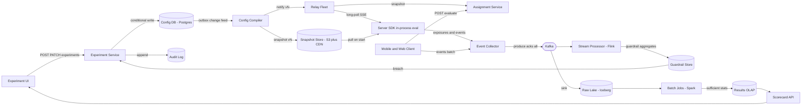
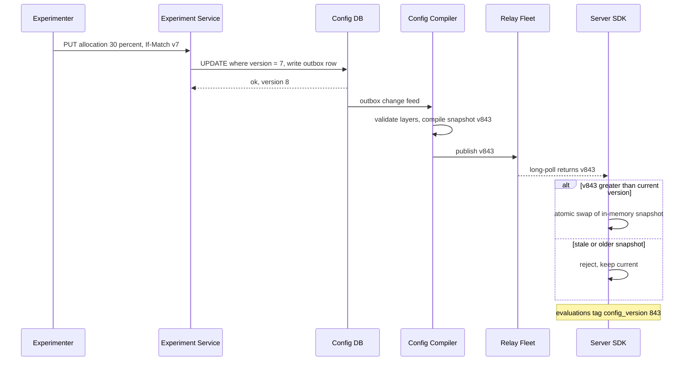
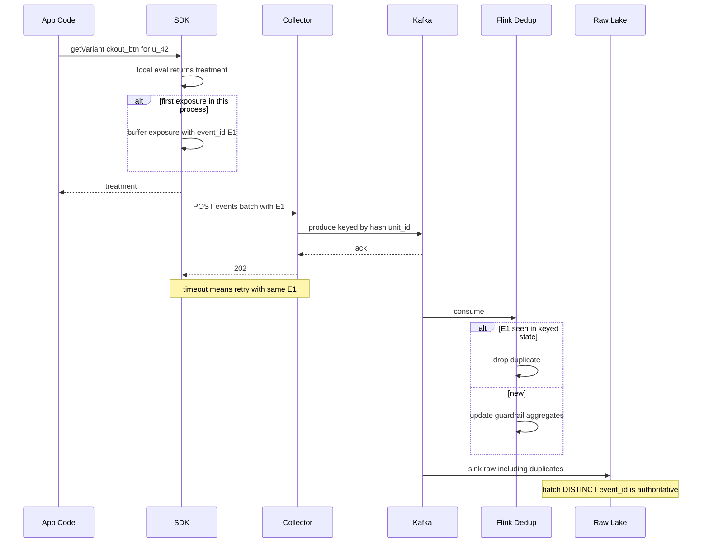
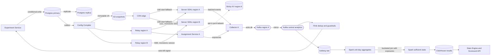

# A/B Testing Platform — System Design

> **Thesis:** *Assignment is a pure function; exposure is the only fact; the scorecard is a reproducible join.*
> - Assignment = `f(config_version, unit_id, salt)` — computed anywhere, stored nowhere, identical on every host.
> - Exposure = the logged moment a unit actually *experienced* a variant — the denominator of every metric.
> - Scorecard = `exposures ⋈ events` under a versioned metric definition — recomputable from raw at any time.

---

## 1. Requirements (~5 min)

**Clarifying questions I'd ask → assumption I commit to**
- Internal platform for many products (web, iOS, Android, backend services)? → **Yes, multi-tenant, multi-client.**
- Feature flags too, or only experiments? → **Same evaluation engine; a flag is an experiment with no analysis.**
- Randomization units? → **`user_id` (logged-in), `device_id` (logged-out); `session_id` only for opt-in short-lived tests.**
- Auto-decisions (bandits, auto-ship)? → **Out of scope.** Auto-*kill* on guardrail breach is in scope.

### Functional (top 3)
1. **Configure experiments** — variants, targeting, allocation/ramp, mutual-exclusion layers, lifecycle, overrides.
2. **Assign units to variants** — deterministic, sticky, sub-ms, from server and client SDKs.
3. **Log exposures + events and compute scorecards** — per-variant metrics with valid significance, plus near-real-time guardrails.

### Non-functional
| Quality | Target | Why it's the constraint |
|---|---|---|
| **Assignment latency** | In-process eval **< 1 ms p99**; remote eval **< 10 ms p99** | Evaluated on every request, many flags per request |
| **Availability > consistency (data plane)** | Evaluation **never blocks or fails** the product; falls back to last-known-good or control | A dead experiment platform must not be a dead product |
| **Analysis correctness** | Exposure loss **< 0.1% and unbiased across variants**; effectively exactly-once counting | Biased loss → Sample Ratio Mismatch → invalid result |
| **Config propagation** | Changes live everywhere **< 60 s**; kill switch **< 10 s** | Bad treatment must be stoppable fast |
| **Scale** | ~**1M events/s** ingest, **1000s** of concurrent experiments | Drives the pipeline design |
| **Freshness** | Guardrails **~5 min**; decision scorecards **T+1 daily** (authoritative) | Real-time for safety, batch for truth |

**Capacity:** I'll do math inline only where it changes a decision (evaluation volume → local eval; join cost → pre-aggregate per unit).

---

## 2. Core Entities (~2 min)
- **Experiment** (+ **Iteration**) — hypothesis, owner, unit type, lifecycle state, version
- **Variant** — key, weight, parameter payload
- **Layer** — mutual-exclusion namespace owning a set of parameters and 10,000 buckets
- **TargetingRule / Segment** — eligibility predicate over attributes
- **Override** — forced assignment for QA / allowlists
- **ConfigSnapshot** — immutable, versioned, compiled view of all running config per environment
- **Exposure** — `(unit, experiment, iteration, variant, first_seen_ts, config_version)`
- **Event** — product telemetry (`purchase`, `click`, `latency_ms`)
- **MetricDefinition** — versioned semantic definition of a metric
- **Scorecard** — per-variant results for a (experiment, metric, date) with stats

---

## 3. API / System Interface (~5 min)

### Control plane (REST, human-facing; caller identity from auth token)
```
POST   /experiments                          -> create (state=DRAFT)
PATCH  /experiments/{id}        If-Match: v7 -> edit (optimistic concurrency)
POST   /experiments/{id}/transitions         {to: "RUNNING" | "PAUSED" | "STOPPED", reason}
PUT    /experiments/{id}/allocation          {percent: 20}            -> ramp
POST   /experiments/{id}/overrides           {unit_id, variant, expires_at}
POST   /metrics                              -> versioned metric definition
GET    /experiments/{id}/scorecard?metric=&segment=&as_of=
GET    /audit?entity=experiment/{id}
```

### Data plane
```
GET  /v1/snapshots/{env}?since=842     -> 304 or snapshot v843   (server SDKs / relay; long-poll or SSE)
POST /v1/evaluate                       -> {assignments:[{exp, iteration, variant, params}], config_version}
                                           (thin/mobile clients; unit derived from token / device id)
POST /v1/events:batch                   -> 202  (exposures + events, each with client event_id)
```

### Data models
```jsonc
// Experiment (control-plane row, versioned)
{
  "id": "ckout_btn", "version": 7, "state": "RUNNING", "iteration": 1,
  "unit_type": "user_id", "layer_id": "checkout",
  "layer_buckets": [[0, 2000]],              // 20% of the layer's 10,000 buckets
  "salt": "9c2e",                            // per experiment-iteration
  "variants": [{"key":"control","weight":50,"params":{"btn_color":"grey"}},
               {"key":"treatment","weight":50,"params":{"btn_color":"green"}}],
  "targeting": {"all": [{"attr":"country","op":"in","v":["US","CA"]},
                        {"attr":"app_version","op":">=","v":"5.2.0"}]},
  "primary_metric": "checkout_conversion@v3",
  "guardrails": ["crash_rate@v2", "p99_latency@v1"],
  "planned_sample_size": 400000
}

// Exposure (logged)
{ "event_id":"01J9...(uuidv7)", "type":"exposure", "unit_type":"user_id", "unit_id":"a_83f1...",
  "experiment":"ckout_btn", "iteration":1, "variant":"treatment",
  "config_version":843, "client_ts":"...", "server_ts":"...", "sdk":"ios-3.4" }

// MetricDefinition (versioned, code-reviewed)
{ "name":"checkout_conversion", "version":3, "type":"proportion",
  "numerator": {"event":"purchase", "agg":"any"}, "unit":"user_id",
  "window": "exposure_ts .. exposure_ts + 7d" }
```

---

## 4. Data Flow (~5 min)
1. Experimenter authors config → validated (conflicts, targeting, metrics) → state machine transition.
2. Control plane **compiles** a new immutable `ConfigSnapshot vN` → publishes to blob store / CDN / push channel.
3. SDKs pull `vN`, **evaluate locally**: overrides → holdout → layer bucket → targeting → variant.
4. At the **point of use**, SDK logs an **exposure**; product emits events. Both batched to the collector.
5. Collector → **Kafka** → (a) stream job: dedup + guardrails; (b) raw, immutable lake tables.
6. Daily batch: `first exposure per unit` ⋈ `per-unit metric aggregates` → **sufficient statistics per variant** → stats engine → scorecard in OLAP.

---

## 5. High-Level Design (~10–15 min)

Going endpoint by endpoint:

- **`POST/PATCH /experiments`, `/transitions`** → **Experiment Service** writes to **Config DB (Postgres)**. Relevant columns: `id, version, state, layer_id, layer_buckets, salt, iteration`. Every edit is `UPDATE ... WHERE version = N` (conditional write); every change also appends to **Audit Log**.
- **Snapshot publish** → **Config Compiler** listens to committed changes (outbox), builds snapshot `vN+1`, uploads to **Snapshot Store (S3) + CDN**, notifies **Relay** fleet.
- **`GET /snapshots`** → server SDKs hold the snapshot **in memory** and evaluate in-process. *Callout: caching/propagation consistency → Deep Dive 6.3.*
- **`POST /evaluate`** → stateless **Assignment Service** (same evaluation library, snapshot in memory) for mobile/web clients.
- **`POST /events:batch`** → **Event Collector** → **Kafka** (`exposures`, `events` topics, keyed by `hash(unit_id)`). *Callout: dedup/idempotency → 6.4.*
- **Analytics** → **Stream Processor (Flink)** for guardrails → **Guardrail Store**; **Lake (Iceberg on S3)** + **Batch (Spark)** → **Results OLAP (ClickHouse/Pinot)** → **Scorecard API**. *Callout: join cost + stats → 6.5.*



---

## 6. Deep Dives (~10 min)

### 6.1 Stable assignment: hashing + salt, weights, ramp, cross-device

**Mechanism — two independent hashes**
- `layer_bucket = H(layer_salt ‖ unit_id) mod 10000` → **which experiment in the layer** owns this unit (mutual exclusion).
- `variant_bucket = H(exp_salt ‖ iteration ‖ unit_id) mod 10000` → **which variant** within that experiment, via cumulative weights.
- `H` = **murmur3/xxhash64 over UTF-8 bytes**, never a language `hashCode()` (differs across JVM/Swift/JS). Ship **golden test vectors** that every SDK must pass in CI.

**Why a salt per experiment:** without it, `H(unit_id)` puts the same users in the "low buckets" of *every* experiment → treatment groups are **correlated across experiments** and carryover from one test biases the next. A fresh salt makes each experiment's split **statistically independent** of every other.

**Worked example** (computed with `SHA-256[:8] mod 10000` for illustration). Layer `checkout`: `ckout_btn` owns layer buckets `[0,2000)`, `ckout_copy` owns `[2000,3000)`; `ckout_btn` is 50/50 (`<5000` → control).

| unit | layer bucket | owner | variant bucket (iter 1) | variant | variant bucket (iter 2, new salt) |
|---|---|---|---|---|---|
| u_42 | 1181 | ckout_btn | 7124 | treatment | 6343 → treatment |
| u_77 | 3957 | unallocated → default | 6435 | — | 3572 → control |
| u_1001 | 2361 | ckout_copy | — | — | — |

- **Ramp 20% → 30%:** `ckout_btn` gets `[0,2000) ∪ [3000,4000)`. u_42 stays in and **stays treatment** (variant hash untouched); u_77 (3957) now enters as **treatment**. Existing assignments are monotonic.
- **Changing weights (50/50 → 80/20) mid-flight is a trap:** it reshuffles users between variants *and* mixes time periods with different ratios (Simpson's-paradox risk). Rule: **ramp allocation, never weights.** If weights must change → new **iteration** (new salt), analyze only iteration 2 — note u_77 would flip treatment → control.
- **Ramp traffic ≠ split ratio:** a "10% treatment" is `allocation=20%, split 50/50`, so control and treatment are equal-sized and contemporaneous.

**Cross-device / identity consistency**
- Experiment declares its **unit type**; assignment only uses that id. `user_id` experiments are **consistent across devices for free** (same input → same hash).
- **Login transition:** logged-out traffic has no `user_id` → user-level experiments return default and **log no exposure** pre-login. Don't "upgrade" a `device_id` assignment to user — it flips variants mid-session.
- **Attribute drift** (user moves country, upgrades app) can flip eligibility. For experiments where that matters (pricing), opt into a **sticky assignment store**: `PUT IF ABSENT (unit, exp, iteration) → variant`, region-local KV. It trades statelessness for stickiness, so it's opt-in, not default.

*DDIA Ch. 6 — hash partitioning: same idea (uniform, deterministic key → slot); a stable hash beats range assignment for the same reasons.*

### 6.2 Experiment conflicts: layers, priority, overrides, holdouts

- **Layer = parameter ownership.** A parameter (`checkout.btn_color`) belongs to exactly one layer. Experiments **in the same layer are mutually exclusive** (disjoint bucket ranges); experiments **in different layers overlap orthogonally** (independent salts). Validation **rejects** two layers touching the same parameter → conflicts are caught at config time, not at runtime.
- **Evaluation order (priority):**
```
1. override(unit, exp)         -> forced variant, exposure tagged is_override=true (excluded from analysis)
2. global holdout (1-5%)       -> default for every launch in scope; measures cumulative impact
3. layer_bucket -> owning exp  -> else default
4. targeting predicate         -> else default, NO exposure
5. variant_bucket -> variant   -> return params
```
- **Targeting before variant, but after layer bucketing** — so ineligible units don't shift anyone else's bucket; experiment sizes are "X% of eligible traffic in its slice."
- **Overrides** carry `expires_at` and are audited; overrides are never counted in scorecards.

### 6.3 Config propagation: correctness vs latency

**Why local eval (the math that decides it):** say 100K requests/s × ~50 flag reads/request = **5M evaluations/s**. As RPCs that's a new tier-0 service in every request path. As an in-process hash over an in-memory snapshot it's ~microseconds and zero network. → **Server SDKs evaluate locally; only clients that can't hold full config call `/evaluate`.**

**Propagation design**
- Postgres is **source of truth** (strong consistency for lifecycle transitions); the data plane only ever sees **immutable, monotonically versioned snapshots**.
- Relay fleet fans out via long-poll/SSE; CDN/S3 is the cold-start fallback.
- **Monotonic reads:** SDK **rejects any snapshot with version < current** — a stale CDN edge must not roll a host back. *(DDIA Ch. 5 — monotonic reads.)*
- **Last-known-good:** relay/CDN outage → keep serving vN indefinitely; never fetched → compiled-in defaults = control.
- **Every exposure carries `config_version`**, so analysis can exclude the propagation window or detect mixed-version exposure.

**The residual inconsistency** — during a rollout of vN+1, host A (vN) and host B (vN+1) disagree for seconds. Acceptable because assignment-changing edits are rare (ramps are monotonic, weight changes force a new iteration). **Kill switch** is a separate tiny snapshot delta pushed at high priority; seconds of inconsistency while *stopping* is fine.

**Mobile** gets **remote evaluation**: `/evaluate` at session start returns only *this user's* assignments (doesn't ship every experiment and targeting rule to the device — leaks unreleased features and sensitive targeting logic). Cache on device; **apply at next session start** to avoid mid-session flicker.



### 6.4 Exposure & event tracking

**Log exposure at point of use, not at assignment.** If `/evaluate` returns 40 assignments at app start but the user never opens checkout, logging all 40 **dilutes** the effect with units who never saw the change. The SDK's `getVariant()` / `getParam()` logs the exposure when the code path actually branches — for **control too** (the counterfactual).

**Idempotency & dedup (three layers)**
| Layer | Mechanism | Purpose |
|---|---|---|
| SDK | In-memory LRU of `(unit, exp, iteration)` already exposed this process | Volume: exposures ~1 per unit per experiment, not per request |
| Transport | Client `event_id` (UUIDv7); retries resend same id; Kafka `acks=all`, idempotent producer | No loss on retry, no amplification |
| Pipeline | Stream: keyed state dedup by `event_id` (24–48h TTL). Batch: `DISTINCT event_id` on raw — **authoritative** | Effectively-once counting even with replays |

- **Exposure table semantics:** keep `MIN(ts)` per `(unit, exp, iteration)` → the **first exposure** anchors the metric window. Idempotent by construction — re-ingesting duplicates doesn't change `MIN`.
- **Mobile offline:** SDK persists batches to disk, flushes with backoff; late arrival up to days → batch reprocesses a trailing window (e.g., last 3 days).
- **Timestamps:** keep both `client_ts` (skewed) and `server_ts`; windowing uses server time with client time as a sanity bound.
- **Auditability:** raw lake is **append-only, immutable, partitioned by date/hour** — every scorecard is reproducible from (raw data, metric def version, pipeline version).
- **Server vs client logging:** prefer server-side exposure/event logging where possible (no ad blockers, no client clock skew); client logging is required for UI-only changes.

*DDIA Ch. 11/12 — idempotence via request ids and the end-to-end argument: dedup must happen at the consumer boundary, not be assumed from the broker.*



### 6.5 Metrics & analytics

**Metric definitions as versioned code** — type (`count`, `sum`, `proportion`, `ratio`, `quantile`), source event + filters, **analysis unit**, attribution window relative to first exposure. Changing a definition = new version; old scorecards keep their version.

**The join is the expensive part — compute once per unit, reuse across all experiments.**
- Naive: for each of 1000s of experiments, join its exposures with ~86B raw events/day (1M/s × 86,400). Infeasible.
- Instead: **(1)** aggregate raw events → `unit_day_metrics(unit_id, date, m1, m2, …)` **once per day** (~hundreds of millions of rows); **(2)** join with `exposures(unit_id, exp, variant, first_ts)`; **(3)** reduce to per-variant **sufficient statistics**.
- Bucket both tables by `hash(unit_id)` → **sort-merge bucket join, no shuffle**. *(DDIA Ch. 10 — sort-merge and bucketed joins.)*

**Store sufficient statistics, not raw per-variant data.** Per (exp, variant, metric, date, segment): `n, Σx, Σx², Σy, Σy², Σxy`. Means/variances are **composable across days/segments**; `Σxy` enables the delta method. **Quantiles aren't composable** → store a **t-digest/KLL sketch** per cell, or bootstrap in batch.

**Real-time vs batch**
| | Stream (Flink) | Batch (Spark) |
|---|---|---|
| Use | Guardrails, auto-kill, "is it logging?" | Ship/no-ship decisions |
| Freshness | ~minutes | T+1 |
| Correctness | Approximate (partial data, late events missing) | Authoritative, late-data corrected, replayable |
| Stats | Threshold/sequential tests on guardrails only | Full scorecard |

Real-time numbers are **never** used for ship decisions — peeking inflates false positives.

**Statistics that trip people up**
- **SRM check first, gate everything:** χ² test of observed vs expected split. E.g., 50,000 vs 48,800 on a 50/50 → χ² ≈ 14.6, **p ≈ 0.00013** → scorecard **blocked**; something is dropping treatment exposures (crash before logging, redirect, bot filter). 50,000 vs 49,700 → p ≈ 0.34, fine.
- **Analysis unit ≠ randomization unit:** randomized by user, metric is CTR per page view → page views within a user are correlated; a naive t-test **understates variance**. Use the **delta method** (or cluster bootstrap) on user-level `Σclicks / Σviews`.
- **Variance reduction:** **CUPED** — regress out pre-experiment value of the same metric; often cuts required sample size substantially for engaged-user metrics.
- **Peeking:** either fixed horizon with pre-registered `planned_sample_size`, or **sequential testing** (mSPRT / always-valid p-values) if the UI shows daily results.
- **Multiple testing:** 1 **pre-declared primary** metric at α; secondary metrics with **Benjamini–Hochberg FDR**; multi-arm → correct for comparisons vs control (Bonferroni/Dunnett); guardrails one-sided, non-inferiority.
- **Continuous A/A tests** run permanently: false-positive rate should track α — the pipeline's own health check.

### 6.6 Architecture hardened: storage, caching, HA

| Component | Store | Why |
|---|---|---|
| Config + lifecycle | **Postgres** (single-writer, replicas) | Tiny data, needs transactions + conditional writes; not a scale problem |
| Snapshots | **S3 + CDN**, relay in-memory | Immutable blobs, cacheable forever by version |
| Assignment | **None (stateless)**; optional region-local KV sticky store | Determinism removes cross-region coordination |
| Ingest | **Kafka**, RF=3, `min.insync.replicas=2`, keyed by `hash(unit_id)` | Durability dial is `min.insync.replicas`; high-card key avoids hot partitions |
| Raw | **Iceberg on S3** | Immutable, replayable, supports row-level deletes (GDPR) |
| Results | **ClickHouse/Pinot** over sufficient-stats cells | Fast slice/dice by segment and date |

- **Data plane has no remote dependency in steady state:** Postgres down → can't *edit*, can still *evaluate*. Relay down → last-known-good. Collector down → SDK disk buffer. Kafka partition leader loss → producer retries (latency, not loss).
- **Multi-region:** snapshots replicated per region; hashing is deterministic, so all regions agree on assignment with **zero coordination**. Control plane single-region primary is fine (low write rate).



### 6.7 Data quality & governance

- **Completeness watermarks** per source/region: day D's scorecard computes only after watermark ≥ D+1 + grace; otherwise marked *partial*.
- **Late data & replay:** batch recomputes a trailing N-day window; after a pipeline bug, **replay from raw Iceberg** — every scorecard row stamped `(metric_def_version, pipeline_version, config_versions)`.
- **Loss must be unbiased:** SRM is the tripwire; per-variant logging-rate dashboards localize the cause.
- **Lifecycle state machine** `DRAFT → REVIEW → RUNNING ⇄ PAUSED → STOPPED → ARCHIVED`, each transition a conditional write; `RUNNING` locks unit type, layer, salt and weights (changing them requires a new iteration).
- **Audit log:** append-only (actor, diff, reason, ts) for every config change, override, ramp, and kill — separate table, no updates/deletes.
- **RBAC:** `viewer` → `experimenter` (own team's experiments, ramp ≤ 50%) → `approver` (ramp > 50%, pricing/payments layers, sensitive targeting — **two-person rule**) → `admin`. Certified metrics owned by metric teams; experimenters can't edit them.

### 6.8 Privacy & compliance

- **Pseudonymous unit ids** — analytics id derived from user_id via keyed hash held in an identity service; the lake never stores email/phone.
- **Targeting attributes are evaluated, not logged** — exposure records carry only `(exp, variant)`, never the attribute values that qualified the unit. Sensitive targeting rules stay server-side (remote eval), never shipped to devices.
- **Retention tiers:** raw events ~90 days; per-unit aggregates ~13 months (YoY comparisons); **sufficient-stats aggregates indefinitely** (no user-level data).
- **Deletion (GDPR/CCPA):** delete identity mapping + Iceberg row-level deletes on per-unit tables by `hash(unit_id)` partition, within SLA (e.g., 30 days). Aggregates are already non-identifying — no recompute needed.
- **Consent:** opted-out users still get assigned (product must work) but emit no telemetry. Consent is decided *before* assignment, so this shrinks the population symmetrically — **no SRM**.
- **Data residency:** EU events processed in-region; only aggregates cross regions.

### 6.9 Failure modes

| Failure | Symptom | Mitigation |
|---|---|---|
| SDK hash mismatch across platforms | Same user, different variants on iOS vs web | Golden test vectors in every SDK's CI |
| Stale CDN snapshot | Host evaluates old config | Monotonic version check; reject older |
| Treatment crashes before logging | SRM, treatment looks better (survivors) | SRM gate blocks scorecard; crash-rate guardrail |
| Weight change mid-flight | Reshuffle, Simpson's paradox | Weights locked while RUNNING; new iteration |
| Collector outage | Event gap | SDK disk buffer + retries with same `event_id`; watermark marks day partial |
| Duplicate delivery on replay | Inflated counts | `DISTINCT event_id` in batch; `MIN(ts)` exposure |
| Bot traffic concentrated in one arm | Noisy / SRM | Bot filtering applied *before* exposure logging, symmetric across arms |
| Peeking at daily results | False positives | Sequential testing or locked fixed horizon |

---

## Key Trade-offs

| Decision | Chosen | Rejected | Why |
|---|---|---|---|
| **Where to evaluate** | In-process SDK (server); remote eval (mobile) | Central RPC for everything | 5M evals/s; availability; mobile gets remote to avoid leaking config |
| **Stickiness** | Stateless deterministic hash | Assignment table for all | No storage, no cross-region consistency; opt-in sticky store only where drift matters |
| **Exposure point** | At point of use | At assignment | Avoids dilution |
| **Config consistency** | Eventual, versioned, monotonic | Linearizable reads per request | Seconds of skew is harmless when assignment-changing edits are rare and locked |
| **Analytics** | Stream for guardrails + batch for truth | Kappa only | Batch replay over immutable raw is simpler to make exact; stream is for safety only |
| **Storage of results** | Sufficient stats + sketches | Raw per-unit in OLAP | Composable, small, privacy-friendly |

---

## Real-World Anchor

- **Google — "Overlapping Experiment Infrastructure" (Tang et al., KDD 2010):** the origin of **layers and domains** — parameters partitioned into layers so experiments in different layers overlap and those in the same layer are exclusive. Maps directly onto 6.2 (and onto the Google-internal mental model you already have).
- **Microsoft ExP (Kohavi et al.):** popularized **SRM as a gating check** and **CUPED** variance reduction (Deng et al., WSDM 2013); *Trustworthy Online Controlled Experiments* (2020) is the canonical reference for the stats pitfalls in 6.5.
- **Netflix / LinkedIn / Uber:** each publicly describes a similar split — deterministic hashing in client libraries, a streaming path for near-real-time monitoring, and a batch path for decision-grade analysis; Netflix has written about **sequential testing** to make early looks safe.
- *(The Bytebytego archive in this project doesn't cover experimentation platforms, so anchors here come from the published papers above.)*

**DDIA references:** *Ch. 5 (monotonic reads, eventual consistency for config), Ch. 6 (hash partitioning ≈ bucketing), Ch. 10 (sort-merge / bucketed joins for exposure ⋈ events), Ch. 11 (stream dedup, idempotence), Ch. 12 (lambda vs kappa, end-to-end argument, reprocessing from immutable logs).*

---

## 🔍 Senior-Signal Questions to Ask in Your Interview

- **"Is the randomization unit the same as the analysis unit for the primary metric — and if not, are we using the delta method?"** → *Why it matters: shows you know naive t-tests on page-level metrics understate variance and manufacture significance.*
- **"What happens to in-flight users if someone changes variant weights on a running experiment?"** → *Why it matters: separates people who know ramp-allocation-not-weights and iteration salts from those who'd silently corrupt a test.*
- **"Where exactly do we log exposure, and what's our SRM policy when it fires?"** → *Why it matters: exposure placement and SRM gating are the two biggest sources of wrong launch decisions in practice.*
- **"How stale can an SDK's config be, and what guarantees prevent a host from going backwards?"** → *Why it matters: frames config propagation as a consistency-model choice (eventual + monotonic) rather than hand-waving 'we cache it'.*
- **"If we find a bug in a metric definition from three weeks ago, can we reproduce and correct every affected scorecard?"** → *Why it matters: tests immutable raw data, versioned definitions, and replay — the auditability story.*