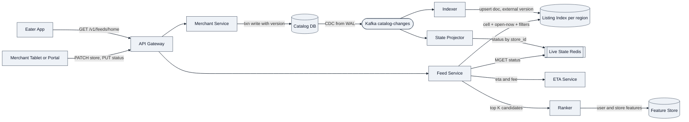
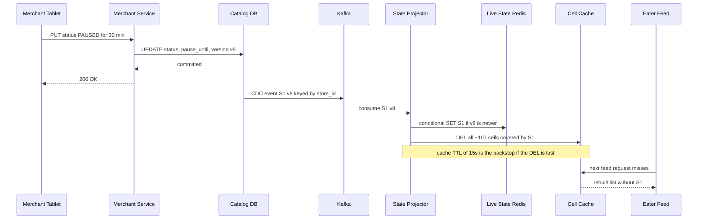
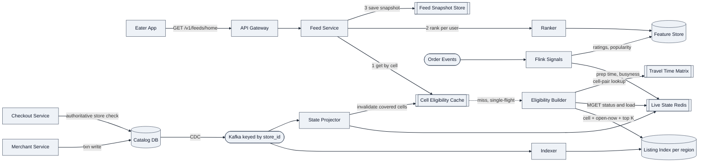
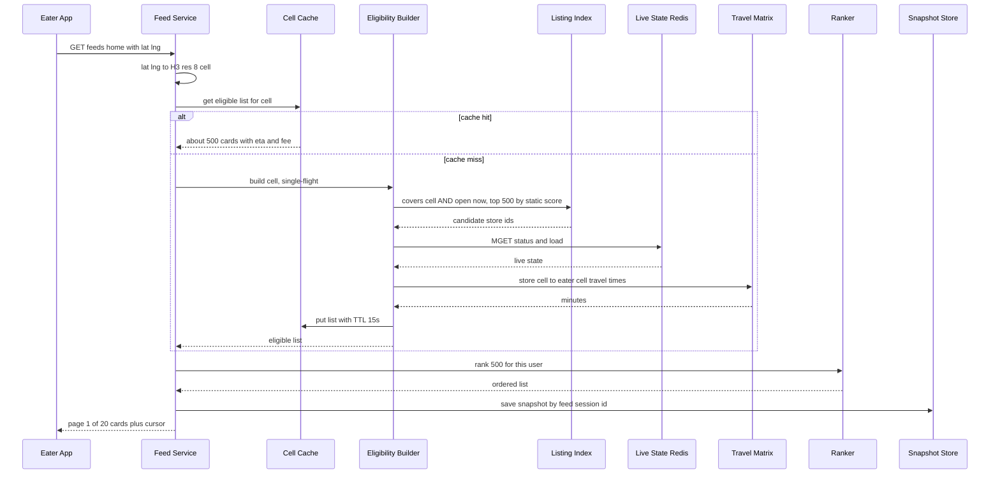

# Uber Eats — Restaurant Listings Data Flow

> **Organizing thesis: Index the slow, join the fast — and let checkout tell the truth.**
> Store attributes that change rarely (location, delivery zone, hours, cuisine, menu text) go into a geo-search index via CDC. State that changes by the minute (paused, busy, prep time, ETA) is **never indexed**: it's joined in at read time from a KV store. The listing is a derived, eventually-consistent view, so it's allowed to be a few seconds stale. Checkout validates against the source of truth.

---

## 1. Requirements (~5 min)

### Clarifying questions I'd ask
- Is "deliverable" defined by a **radius** or by a **merchant-drawn delivery zone polygon**? → *Assume polygon (real-world: zones follow bridges and rivers).*
- Does a listing card show **ETA and delivery fee**? → *Yes, as an estimated range.*
- Is the feed **personalized**? → *Yes, ranked per user. Ads and promos are out of scope.*
- When a merchant hits "pause", how quickly must the store disappear? → *Within seconds. A paused store in the feed causes a failed checkout.*

### Functional requirements (top 3)
1. **Eaters can see a ranked list of restaurants that can deliver to their location right now**, with an ETA range, fee and rating on each card.
2. **Eaters can filter or search the list** (cuisine, dietary, price tier, dish name).
3. **Merchants can update their store** (hours, menu, delivery zone, pause/unpause), and those changes show up in listings.

*Out of scope: ordering, payment, courier dispatch, store detail page, ads.*

### Non-functional requirements (quantified)
| NFR | Target |
|---|---|
| **Feed latency** | p99 < **300 ms** server-side, p50 < 100 ms |
| **Freshness, fast lane** (pause/unpause, busyness) | ≤ **10 s** typical, ≤ **30 s** worst case |
| **Freshness, slow lane** (menu, tags, zone, hours edits) | ≤ **2 min** |
| **Availability vs consistency** | Feed reads **AP**: stale beats unavailable, 99.99%. Merchant writes are durable on the primary. |
| **Scale** (assumed) | ~**1M stores**, ~**50k feed QPS** at the dinner peak, read:write ≥ 1000:1, heavy skew toward dense urban cells |

### Capacity estimation
I won't front-load it. I'll do the math inline where it **changes a decision**: whether the index needs sharding, the cost of hydrating candidates, and whether to call the routing engine per request.

---

## 2. Core Entities (~2 min)

- **Store**: location, delivery zone polygon, hours schedule, cuisine/dietary tags, price tier
- **Menu / Item**: dish names for search (slow-moving)
- **StoreState**: status (OPEN/PAUSED/OFFLINE), pause_until, prep load (fast-moving, separate entity)
- **Cell**: an H3 res-8 hexagon, the unit of retrieval and caching
- **FeedSnapshot**: the ranked list served to one eater session, used for stable pagination

Splitting **Store** from **StoreState** is the thesis, expressed as entities.

---

## 3. API (~5 min)

REST. The eater and merchant identity always come **from the auth token**.

```
# Eater
GET  /v1/feeds/home?lat=..&lng=..&cursor=..
     → { cards: [{store_id, name, eta_min, eta_max, fee, rating, image_url}], next_cursor }

GET  /v1/stores?lat=..&lng=..&cuisine=..&dietary=..&price=..&q=..&cursor=..
     → same card shape (filter/search)

# Merchant (token is scoped to the store; storeId is checked against the token's grants)
PATCH /v1/merchant/stores/{storeId}                 { hours, tags, delivery_zone, ... }
PUT   /v1/merchant/stores/{storeId}/status          { state: PAUSED, duration_min: 30 }
PATCH /v1/merchant/stores/{storeId}/menu/items/{id} { name, available, ... }
```

- `cursor` is opaque: `(feed_session_id, offset)`. Its use is explained in Deep Dive 4.
- The pause request takes a **duration**, not a boolean, so auto-unpause needs no timer (Deep Dive 2).

---

## 4. Data Flow (~5 min)

This is mostly a derived-data pipeline, so the ordered flow matters.

**Write side (merchant → index)**
1. The merchant edits a store. Merchant Service commits to **Catalog DB**, the source of truth, with a row `version`.
2. **CDC** (Debezium on the WAL) publishes the change to Kafka, **keyed by `store_id`**. The key is high-cardinality, which gives per-store ordering without hot partitions.
3. **Slow lane:** the Indexer denormalizes the store into a listing doc, computes the H3 cells its delivery zone covers, and upserts the doc into the **Listing Index** with external version = row version.
4. **Fast lane:** the State Projector writes status changes to **Live State (Redis)** and invalidates the cell caches for the affected cells.
5. **Signals:** Flink aggregates order events into prep time and busyness (written to Redis) and into ratings and popularity (written to the Feature Store).

**Read side (eater → feed)**

6. lat/lng → **H3 res-8 cell**.
7. **Retrieve:** query the index for stores whose zone covers the cell, are open now by schedule and match the filters, and keep the top K by static score.
8. **Hydrate:** batch-read live state and look up ETA/fee for those K, then drop paused and offline stores.
9. **Rank** per user, **snapshot** the result, and return page 1.

---

## 5. High-Level Design (~10–15 min)

### Endpoint by endpoint

**`PATCH /merchant/stores/{id}` and `PUT .../status`**
- Merchant Service → **Catalog DB** (sharded relational/document DB keyed by `store_id`). One transaction per edit, with `version++`.
- No dual write to the index or Redis. Both are **derived views** fed by CDC (*DDIA Ch. 11, "Change Data Capture"*), so durability lives in the DB.
- The merchant portal reads its own store **from the DB, not from the index**, which gives read-your-writes for the merchant (*DDIA Ch. 5, "Reading Your Own Writes"*).

**`GET /feeds/home`**
- Feed Service → Listing Index (retrieve) → Live State (hydrate) → ETA Service → Ranker (+ Feature Store) → response.

### Architecture (first cut)



### Design-relevant fields

**Listing Index doc** (slow lane):

| Field | Why it's there |
|---|---|
| `covering_cells[]` | H3 res-8 cells covered by the delivery zone. An inverted posting list (cell → store_ids) answers "who delivers here" |
| `open_intervals[]` + `tz` + `special_hours` | Weekly schedule in **store-local** minute-of-week. "Open now" is computed at query time |
| `cuisine_tags`, `dietary_tags`, `price_tier`, `name`, `dish_text` | Filters and full-text search |
| `static_score` | Precomputed quality/popularity score, used for first-pass pruning |
| `version` | External version, so a stale CDC event can't overwrite a newer doc |

**Live State (Redis hash `store:{id}`)** (fast lane): `status`, `pause_until`, `prep_p50_min`, `load_factor`, `version`.

**Callouts deferred to deep dives:** the hot downtown cell (candidate fan-in), the ETA cost per candidate, the pause propagation path, and pagination stability.

---

## 6. Deep Dives (~10 min)

### Deep Dive 1: Geo retrieval with an H3 covering, and whether to shard

*DDIA Ch. 3 ("Multi-dimensional indexes") uses this exact case: a B-tree on lat or lng can't answer a 2-D restaurant query, so you need a space-filling curve or an R-tree.* I go one step further and **precompute the covering at write time**:

- **Write time:** polyfill each store's delivery-zone polygon into H3 res-8 cells (~0.74 km² each). The doc stores `covering_cells[]`.
- **Query time:** compute the eater's cell, then do one term lookup. There's **no point-in-polygon test per request**, because the expensive geometry runs once per zone edit instead of once per feed load.
- **Why not geohash plus radius** (Alex Xu Vol 2, Proximity Service)? It works for "restaurants within 5 km". But delivery zones are irregular (a river, a bridge, a toll road), and a radius over- or under-includes. Hexagons also have uniform neighbor distances, which the ETA matrix in DD3 depends on.

**Math that decides sharding:**
- A 5 km-radius zone is ≈ 78 km², or **~107 res-8 cells** per store.
- 1M stores × 107 ≈ **1.1 × 10⁸ postings** × 4–8 B ≈ **0.4–0.9 GB**. Docs add 1M × ~2 KB ≈ **2 GB**.
- **Decision:** a whole region's index fits in RAM on one node, so I **don't scatter-gather shard**. I **partition by geography (region/metro)** and **replicate each partition** for QPS.
- *DDIA Ch. 6 (partitioning secondary indexes):* a document-partitioned index normally forces scatter/gather. Partitioning by the **same dimension the query filters on** (geography) means every query hits exactly one partition.

**Hot cell (Manhattan at 6:30 pm):** a downtown cell may be covered by thousands of stores (assume ~3k). Hydrating all of them per request costs 3k keys × ~100 B = 300 KB per request; at 50k QPS that's **~15 GB/s of Redis reads, which is not viable**. So retrieval does **cheap pruning inside the index**: covers-cell AND open-now-by-schedule AND filters, then **top K = 500 by `static_score`**. Only those 500 get hydrated. DD4 then removes most of the remaining hydration cost with a per-cell cache.

### Deep Dive 2: Two freshness lanes (the thesis in practice)

**Why not put `status` / `load_factor` in the search index?**
- Search-index updates are expensive whole-document reindexes (delete + insert into a new segment, followed by merges). Busyness changes every minute for ~1M stores. That causes a **reindex storm and segment churn** to serve fields that are never searched on.
- These fields are only used to **filter and score** a few hundred candidates, so a point lookup at read time is the cheap path. Index the slow, join the fast.

| Field | Lane | Freshness |
|---|---|---|
| Pause / unpause / offline | **Fast**: CDC → Redis + cell-cache invalidation | ≤ 10 s typical, ≤ 30 s worst |
| Prep time / busyness | **Fast**: Flink → Redis | ~1 min |
| Menu, tags, zone, schedule edits | **Slow**: CDC → index | ≤ 2 min |
| Open/closed **transition by schedule** | **None**: computed from `now` at query time | Instant, with no event |
| Ratings / popularity | Batch → Feature Store | Hours |

**Time-based state needs no event.** "Open now" is a pure function of (schedule, tz, now), and pause is stored as `pause_until`, so the eligibility check is `status != PAUSED OR now > pause_until`. That means **no cron job to flip stores open or closed and no timer for auto-unpause**. Store-local intervals plus a tz ID keep DST correct, where UTC-precomputed intervals would break twice a year.

**What happens when there's no event at all:** a store is open by schedule but its tablet has died. The State Projector tracks tablet heartbeats, and a store with **no heartbeat for 2 min becomes OFFLINE** (detected by a periodic sweep). The fast lane therefore has two wake paths: **event-driven** (pause) and **absence-driven** (heartbeat expiry).

**Ordering and idempotency:**
- Kafka is keyed by `store_id`, so events for one store arrive in order.
- The index upsert uses `version_type=external`, and the Redis write is a version-conditional Lua `SET` (only applied if the incoming version is greater than the stored one). Replays and out-of-order redeliveries are **no-ops**, so every state transition is a conditional write.

**Pause propagation, step by step:**



Invalidation fan-out is ~107 cache keys per pause. Pause events number in the thousands per minute, not millions, so this is cheap.

### Deep Dive 3: ETA and fee (the listing ETA is an estimate, the checkout ETA is the promise)

**Math that decides the design:** calling the routing engine for every candidate means 50k QPS × 500 candidates = **25M route computations/s**, which is not viable.

**Listing ETA** = `prep_remaining` (Redis: prep p50 × load factor) + `courier_to_store` (supply estimate per cell) + **`travel(store_cell → eater_cell)`**.
- The travel term comes from a **precomputed H3 cell-pair travel-time matrix**, refreshed every few minutes from live traffic. Per metro this is roughly 5k active cells × ~107 cells in range ≈ **~0.5M pairs**, so it fits in memory and each lookup is a hash get.
- The card shows a **range** (e.g. 25–35 min) to communicate the uncertainty of an estimate.
- An exact route-based ETA is computed only on the store page and at checkout, where it applies to one store, not 500.

### Deep Dive 4: Caching, hot spots and stable pagination

**Key observation:** everything up to hydration (eligible stores, ETA, fee) depends on **(cell, filters, time)**, not on the user. Only ranking is personal.

- **Cell Eligibility Cache**, key `(cell, filter_hash)` → ~500 hydrated cards, **TTL 15 s**, with event invalidation from DD2.
  - Hit-ratio sanity check: assume ~50k QPS over ~50k active cells. That averages ~1 QPS per cell, or ~15 requests per TTL window, for a **~93% hit ratio**. Hot downtown cells see 50+ QPS and hit ~99%+. This also brings the 25M/s ETA problem down to ~(50k cells / 15 s) × 500 ≈ **1.7M in-memory matrix lookups/s**.
  - **Single-flight per key** prevents a stampede of concurrent misses on a hot cell when its entry expires.
- **Per-user ranking** runs on the cached list (500 candidates, light model, ~50 ms budget).
- **FeedSnapshot**: the ranked list is stored under `feed_session_id` (TTL 10 min), and the cursor is `(session, offset)`. Live state changes between page 1 and page 2 therefore **can't cause duplicates or skipped cards**. Each fetched page's ~20 store_ids are re-checked against Live State, which is cheap, and any store paused since page 1 is dropped.

**Hardened architecture:**



**Feed read, time-ordered:**



**Latency budget (p99 ≈ 300 ms):** gateway/auth 20 · cache hit 5 (miss path: index 30 + hydrate 20 + matrix 10) · ranking 50–80 · snapshot write 10 · serialization 20. The miss path stays within budget, and the cache handles the volume.

### Deep Dive 5: Failure modes and how the system degrades

| Failure | Behavior | Rationale |
|---|---|---|
| **Live State Redis down** | **Fail open**: serve index-only eligibility (schedule-based), mark ETA as approximate | Treating the listing as unavailable would block every order. A stale listing costs a few failed checkouts, and checkout validates against the DB |
| **Indexer lag** (consumer lag rising) | Feed serves the slightly older index, and an alert fires on the **event-time → indexed-time** freshness SLO | Lag hurts latency of updates, not availability of reads |
| **Ranker timeout** | Fall back to `static_score` order within the deadline | A degraded ranking still delivers a working feed |
| **Travel matrix stale** | Use the last-good matrix and widen the ETA range | An estimate stays honest when it shows its uncertainty |
| **Bad index build / new field** | **Rebuild from a DB snapshot plus CDC replay** into a new index, then swap the alias | The index is derived data and can be reproduced (*DDIA Ch. 11–12, reprocessing / derived views*) |

**Correctness boundary:** the Checkout Service re-reads store status from **Catalog DB**, the authoritative source. A listing can be up to ~30 s stale on a pause, but it can never cause an order to be accepted for a paused store.

---

## Real-World Anchor

- **Uber's H3:** Uber built and open-sourced the H3 hexagonal grid (2018) for marketplace geospatial work (pricing, dispatch). The cell-pair matrix and per-cell caching above use the same "discretize the city into hexagons" approach.
- **Uber DeepETA:** Uber's published approach uses a routing engine for a base ETA plus an ML model that **corrects the residual**. This supports the split above: a cheap approximation where you need volume (listing), precision where you need a promise (checkout).
- **DDIA Ch. 3, p. 87:** Kleppmann's multi-dimensional-index example is literally *a restaurant-search website*. It's a good line to cite when you justify the geo index.
- **Alex Xu Vol 2, Proximity Service:** geohash/quadtree for "nearby businesses". Contrast it explicitly: **radius search vs. zone-coverage search** is the senior-level distinction for food delivery.

---

## 🔍 Senior-Signal Questions

- **"What's the staleness budget per field, and which lane owns each one?"** → *Why it matters: shows you treat freshness as a per-attribute SLO rather than one global "eventually consistent", and that this drives the index-vs-join split.*
- **"Which is authoritative when the listing and checkout disagree, and what does the eater experience?"** → *Why it matters: shows you know the listing is a derived view (DDIA Ch. 11) and that you've placed the correctness boundary deliberately.*
- **"If the live-state store goes down, do we fail open or closed?"** → *Why it matters: forces an explicit availability-vs-correctness trade-off. Here the answer is fail open, because checkout is the guard.*
- **"What happens to a downtown cell at 6:30 pm when its cache entry expires?"** → *Why it matters: probes hot-spot handling (single-flight, top-K pruning) and back-pressure on Redis and the index.*
- **"How do we add a new indexed field or change the H3 resolution with zero downtime?"** → *Why it matters: shows operational maturity. You rebuild derived data by replay plus an alias swap, without a risky in-place migration.*