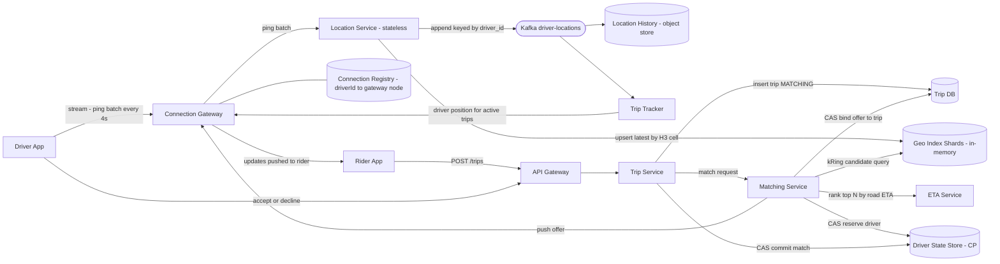
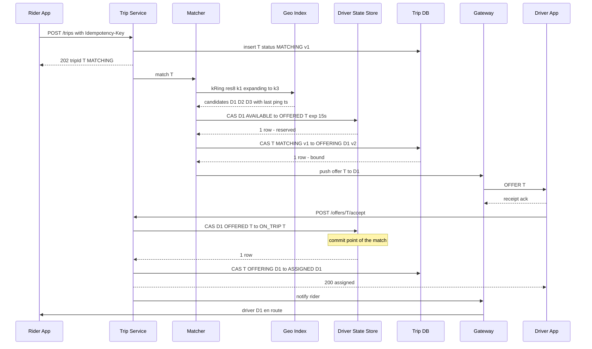
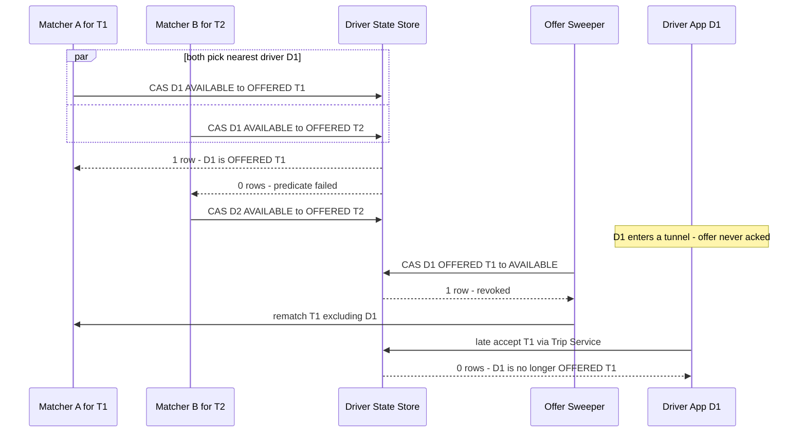
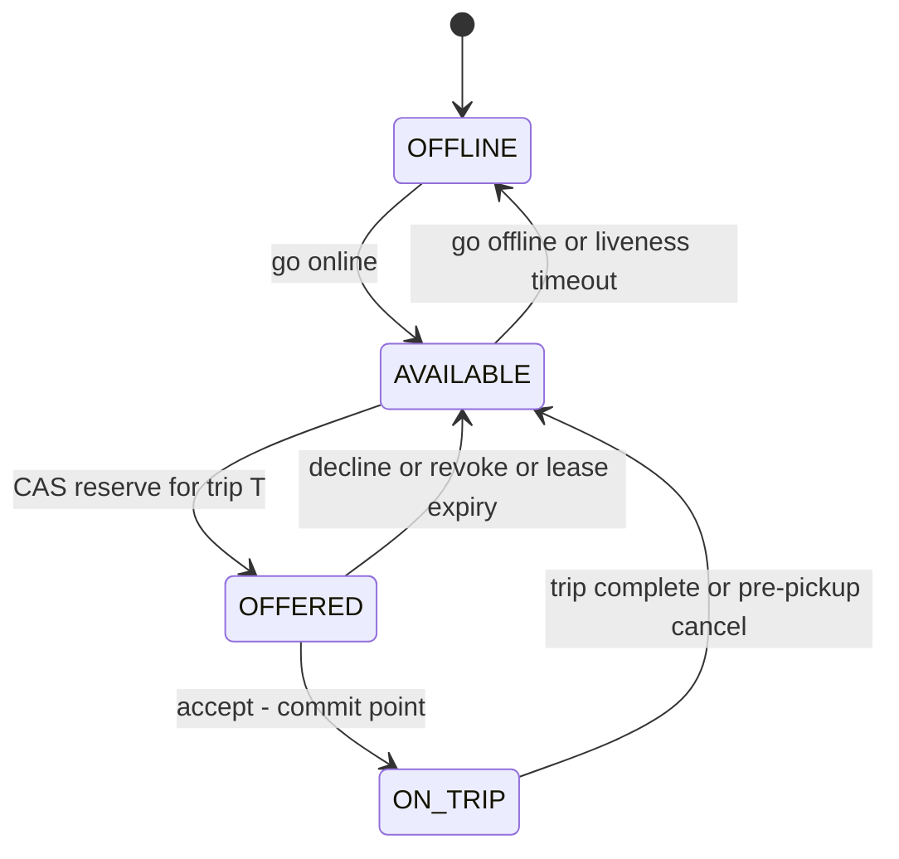
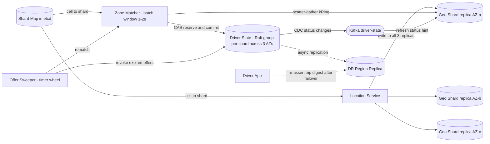

# Design Uber — Core Ride-Sharing (Location Ingest + Matching)

> **Organizing thesis — "Location is soft state; the assignment is hard state."**
> The geo index is *allowed to lie*: it is in-memory, AP, lossy, and heals itself within one ping interval (4 s). The **driver row tells the truth**: every match goes through a single-row **conditional write** on a CP store. That split lets the ~1.25M writes/s path skip consensus entirely, while the ~15K writes/s assignment path can afford linearizability.
> (Same idea as *"let search lie; let the hold tell the truth"*.)

---

## 1. Requirements (~5 min)

### Clarifying questions → committed assumptions
| Question | Assumption |
|---|---|
| Global or single region? | Global, but **each city is homed to one region**. Matching is always city-local. |
| One driver offered at a time, or broadcast to many? | **One outstanding offer per trip**, 15 s accept window. Broadcast is a variant (deep dive). |
| UberPool / shared rides? | Out of scope. One rider-trip per driver. |
| Surge pricing, payments, ratings, routing engine? | Out of scope. **ETA Service** is a dependency. Surge reads from the location stream. |

### Functional (top 3)
1. **Drivers stream their location and availability** (online/offline) in real time.
2. **Riders request a ride and get matched** to a nearby available driver, who accepts or declines.
3. **The rider sees the assigned driver's live location** until pickup and during the trip.

### Non-functional (quantified)
- **Ingest scale:** ~5M concurrent online drivers at peak, 4 s ping interval → **~1.25M location writes/s**.
- **Freshness:** a ping is visible to matching in **p99 < 1 s**.
- **Match latency:** request → offer on the driver's phone in **p99 < 2 s** (not counting the driver's think time).
- **Safety invariant (zero tolerance):** a driver is never bound to two active trips, and a trip never has two drivers. → **CP on the assignment path.**
- **Availability:** 99.99% for request/match within a city. Survive an AZ loss with no downtime and a region loss with bounded RPO. Prefer **degraded** over **down**: stale locations are acceptable, double-booking is not.
- **Mobile constraints:** flaky cellular links, tunnels, battery. Clients must tolerate disconnects, buffer pings, and retry idempotently.

### Capacity — only the numbers that change a decision
| Quantity | Math | Decision it drives |
|---|---|---|
| Location writes | 5M drivers ÷ 4 s = **1.25M/s** | Must be stateless, in-memory, and need no consensus. No indexed DB write per ping. |
| Index working set | 5M × ~150 B ≈ **< 1 GB** | **Fits in one box's RAM.** We shard for **write throughput, NIC bandwidth, and blast radius**, not for memory. |
| Trips | ~30M/day ≈ 350/s avg, assume 5× peak → **~2K/s** | — |
| Assignment writes | ~2K trips/s × (offers + retries + transitions) ≈ **~15K CAS/s** | **~80× below ingest** → a linearizable conditional write per assignment is affordable. This is the CAP split. |
| Location history | 1.25M/s × 100 B = 125 MB/s ≈ **10.8 TB/day raw** (×3 replication in Kafka) | Append-only log, short retention, then sink to object storage. Never a B-tree index per ping. |
| Driver connections | 5M ÷ ~100K per node | ≈ 50+ gateway nodes (2× for AZ headroom). Needs a **connection registry** to push offers. |

---

## 2. Core Entities (~2 min)
- **Driver**: profile, vehicle, products (UberX/XL…).
- **DriverState** *(hard state, CP)*: `status, trip_id, offer_expires_at, version`. **The arbiter of who is bound to whom.**
- **DriverLocation** *(soft state, AP)*: `lat, lng, heading, speed, ts, seq, h3_cell`. Ephemeral and superseded every 4 s.
- **Trip**: rider, pickup/dropoff, `status, offered_driver, assigned_driver, version`.
- **Offer**: (trip_id, driver_id, expires_at). Lives inside DriverState and Trip, not as its own table.
- **Rider**: profile, `active_trip_id` (to prevent duplicate trip requests).

---

## 3. API (~5 min)

**Driver ↔ system: a persistent bidirectional stream** (WebSocket or gRPC bidi) through the Connection Gateway. Polling 5M clients with REST is too expensive in handshakes and battery, and the same pipe carries offers *down* to the driver.

```
# Driver upstream (over stream; REST fallback)
POST  /drivers/me/locations         body: [{lat,lng,heading,speed,accuracy,ts,seq}, ...]   # batched
PATCH /drivers/me/status            body: {status: ONLINE|OFFLINE}
POST  /offers/{tripId}/accept       # idempotent; driverId taken from the auth token
POST  /offers/{tripId}/decline

# Rider
POST   /trips                       headers: Idempotency-Key   body: {pickup, dropoff, product}
                                     → 202 {tripId, status: MATCHING}
GET    /trips/{tripId}
POST   /trips/{tripId}/cancel
GET    /drivers/nearby?lat&lng&product          # map of cars; coarse, cached

# Server → client push (over the stream): OFFER, TRIP_ASSIGNED, DRIVER_LOCATION, TRIP_CANCELED
```
- **Identity always comes from the auth token.** No `driverId`/`riderId` in bodies or paths for "me".
- **Batch the pings:** sample GPS at 1 Hz and send a 4-sample batch every 4 s. The history trail gets 1 Hz fidelity while the request rate stays at 0.25/s per driver.
- `seq` is a per-device monotonic counter. The server uses it to drop out-of-order or duplicate pings.

---

## 4. High-Level Design (~10–15 min)



### Endpoint 1: Location ingest (`POST /drivers/me/locations`)
1. The driver app sends a batch over its persistent stream to a **Connection Gateway** node, which registers `driverId → node` in the **Connection Registry**.
2. The **Location Service** (stateless) keeps only the newest sample by `seq`, computes `h3_cell = latLngToCell(lat, lng, res=8)`, and does two writes:
   - **Upsert into the Geo Index shard** that owns that cell (in-memory, O(1)).
   - **Append to Kafka `driver-locations`**, partitioned by `driver_id`. That key has high cardinality, so there are no hot partitions, and each driver's pings stay in order for history, fare trail, surge, and ETA training.
3. **Why a dual write is acceptable here** (normally a red flag): neither target is the source of truth for anything that needs atomicity. Pings are **superseding samples**, so a lost index write is invisible because the next ping overwrites it in 4 s. For the on-trip fare trail, the client keeps pings until the server acks the Kafka write. *(DDIA Ch. 11: the log is the system of record for the stream. The index is a derived, disposable view.)*

**Geo Index entry:** `driver_id → {lat, lng, heading, speed, ts, seq, status_hint, products, cell}` plus `cell → set(driver_id)`. A move between cells is two hash operations: remove from the old cell's set, add to the new one.

### Endpoint 2: Request a ride (`POST /trips`) → matching
1. The **Trip Service** CASes `rider.active_trip_id` from NULL to T (one active trip per rider; the Idempotency-Key dedupes double taps), inserts the trip as `MATCHING`, and returns **202**.
2. The **Matching Service** computes the pickup's H3 cell and queries the index with an **expanding k-ring**: k=1 (7 cells), then k=2 (19), then k=3 (37), until it has about 10 fresh candidates.
3. It filters by `status_hint = AVAILABLE`, product, and freshness (`now − ts < 10 s`), takes the top N by straight-line distance, and **re-ranks them by road ETA**. Straight-line distance across a river or freeway is misleading.
4. **It reserves the best driver with a conditional write** on the Driver State Store, then binds the offer on the Trip row (full protocol in Deep Dive 3).
5. It looks up the driver's gateway node in the registry and **pushes the OFFER**.

### Endpoint 3: Accept (`POST /offers/{tripId}/accept`)
- The **driver row CAS `OFFERED(T) → ON_TRIP(T)` is the commit point of the match.** The Trip row then follows (`OFFERING(D) → ASSIGNED(D)`), and the rider is notified.

### Endpoint 4: Live driver location to the rider
- The **Trip Tracker** consumes `driver-locations`. For drivers whose state is `ON_TRIP(T)`, it forwards positions to the rider's gateway node, found through the registry. A ~50–100 ms Kafka hop is fine against a 4 s ping interval.

> Callouts deferred to Deep Dives: how to pick the geo index structure, shard boundaries, the double-match protocol, offer timeouts, and partitions and failover.

---

## 5. Deep Dives (~10 min)

### Deep Dive 1: Geospatial index — why H3 buckets, not a tree

| Option | Update cost under 1.25M moves/s | Query | Verdict |
|---|---|---|---|
| **DB + B-tree on (lat, lng)** | Index write per ping, WAL plus fsync | 2-D range on a 1-D index | ❌ Wrong tool for the write rate |
| **Quadtree** (Yelp-style) | Moving a point means delete plus insert, and density changes trigger **split/merge churn** | Adapts well to density | ❌ Built for mostly static points of interest, not moving points |
| **Geohash** (e.g., Redis `GEOADD`/`GEOSEARCH`) | O(log N) sorted-set update | Prefix range. **Boundary problem:** nearby points can share no prefix, so you query 8 neighbors at **unequal distances** (corners vs. edges) | ✅ Defensible baseline. Redis is single-threaded per shard. |
| **H3 hex cells + hash buckets** | **O(1)**: move between two sets | `gridDisk(cell, k)`: **all 6 neighbors are equidistant**, so a k-ring approximates a circle | ✅ **Choice** |

**Picking the resolution:** at **res 8** a cell averages ~0.74 km² (edge ~460 m).
- k=1 covers 7 cells ≈ 5 km² (~1.3 km effective radius).
- k=3 covers 37 cells ≈ 27 km² (~2.9 km radius).
- That matches a typical pickup search radius, and a busy downtown cell holds tens to low hundreds of drivers, so scanning one cell is cheap.

**Sharding the index** *(DDIA Ch. 6)*:
- **Shard key = a coarse parent cell** (res 4–5), assigned to shards through a **load-weighted shard map** in etcd/ZooKeeper. Dense cities like Manhattan are split across several shards, and sparse regions are grouped onto one. This is key-range partitioning by geography, with request routing via a coordination service *(Ch. 6, "Request Routing")*.
- At ~1.25M/s over ~200 shards, each shard takes ~6K writes/s. That's trivial for a hash map. Again, sharding here is for throughput and blast radius, not RAM.
- **Queries near a shard edge:** the matcher groups k-ring cells by owning shard and **scatter-gathers**, usually across 1–3 shards.
- **A driver crossing into another shard** briefly appears in both. The old entry ages out by TTL, and the freshness filter ignores it. **A duplicate candidate is harmless because the driver-row CAS decides** (thesis).

**Replicating the index without consensus:**
- Each shard has 3 replicas in 3 AZs. The Location Service **writes to all three** (fire-and-forget), and reads go to any healthy replica.
- Replicas can diverge by **at most one ping interval**. A fresh replica warms itself in about 4 s, with no snapshot and no Kafka replay. **Rebuilding means waiting one ping interval.**

### Deep Dive 2: Absorbing millions of writes per second
- **Stateless Location Service** behind the gateways, scaled horizontally. Its only work is a small CPU computation and two non-blocking sends.
- **Adaptive ping rate:** stationary drivers ping every 10–15 s and moving ones every 4 s. Under overload, **the server tells clients to back off** (for example to 8 s). Load drops while correctness holds, because staleness is already tolerated.
- **Load-shedding priority:** accept/cancel/offer traffic first, on-trip pings second, idle pings third, the nearby-cars map last.
- **`GET /drivers/nearby`**: cache the response per (res-8 cell, product) for about 2 s. Riders cluster spatially, so the hit ratio is high, and positions are coarse, which also protects privacy. This keeps rider map reads from multiplying the load on the index.
- **Hot spots** (stadium exit, New Year's Eve, airports) *(DDIA Ch. 6, "Skewed Workloads")*:
  - Split the hot parent cell to its own shard through the shard map.
  - Airports use a **FIFO driver queue** at the staging lot instead of nearest-driver matching.

### Deep Dive 3: Consistency — never double-match a driver

**Why the naive approach fails:** `SELECT driver WHERE status='AVAILABLE'` followed by `UPDATE status='OFFERED'` is **check-then-act**. Two matchers both read AVAILABLE and both write, which is a **lost update** *(DDIA Ch. 7)*. The index's `status_hint` is worse still, because it is stale by design.

**The fix:** every transition is a **single-row conditional write (CAS)**, and the invariant lives in the predicate:

```sql
-- (1) RESERVE (Matcher)            ← the lease
UPDATE driver_state
SET    status='OFFERED', trip_id=:T, offer_expires_at=now()+15s, version=version+1
WHERE  driver_id=:D
  AND (status='AVAILABLE' OR (status='OFFERED' AND offer_expires_at < now()));

-- (2) BIND OFFER (Matcher)         ← one outstanding offer per trip
UPDATE trips SET status='OFFERING', offered_driver=:D, version=:v+1
WHERE  trip_id=:T AND status='MATCHING' AND version=:v;
--     0 rows (rider canceled / another matcher won) → compensate: release D if still OFFERED(T)

-- (3) COMMIT (accept)              ← COMMIT POINT OF THE MATCH
UPDATE driver_state SET status='ON_TRIP', version=version+1
WHERE  driver_id=:D AND status='OFFERED' AND trip_id=:T;

-- (4) FOLLOW (trip side)
UPDATE trips SET status='ASSIGNED', assigned_driver=:D
WHERE  trip_id=:T AND status='OFFERING' AND offered_driver=:D;
--     0 rows because trip CANCELED → compensate driver ON_TRIP(T) → AVAILABLE, notify driver
```

**Why this is correct:**
- **Driver side:** a row has one `status`, and the store makes the CAS on that row **linearizable** *(DDIA Ch. 9: uniqueness constraints need linearizability)*. Two matchers racing for D cannot both get a row back.
- **Trip side:** CAS (2) allows only one `OFFERING` per trip, so two matchers handling the same trip (say a redelivered message) cannot both send offers.
- **`trip_id` inside the predicate acts as the fencing token.** A late accept for a revoked offer fails because the row no longer says `OFFERED(T)`. No separate fencing service is needed because the store has native CAS *(DDIA Ch. 8, fencing tokens)*.
- **The rider side** gets the same treatment: `rider.active_trip_id` CAS plus an Idempotency-Key. Without it, two devices could create two trips. That would be a **write skew** if it were enforced by a query over many rows *(DDIA Ch. 7, the meeting-room booking example)*, so it's enforced on one row instead.

**Two wake paths for offers** (event-driven and scheduled, both required):
- **Event path:** the driver declines, or the driver app doesn't ack receipt within ~3 s (offer probably not delivered). The matcher revokes early instead of burning the full 15 s.
- **Scheduled path:** an **Offer Sweeper** (timer wheel, or a delay queue keyed by `offer_expires_at`) revokes expired offers and re-queues matching for the trip, excluding that driver.
- **Leases expire on their own:** the `OR offer_expires_at < now()` clause in CAS (1) means a lost compensation **can't leak a driver forever**. Both checks use **database time**, never the phone's clock *(DDIA Ch. 8, unreliable clocks)*.

**Crash between (3) and (4):** the driver row says `ON_TRIP(T)` while the trip still says `OFFERING(D)`. The sweeper sees the expired offer, **reads the driver row first, and rolls forward** to (4) instead of re-matching. **The driver row is the source of truth for the binding**, and the trip row is reconciled to it.



**The races, traced:**



**Driver state machine** (owned by DriverState; the Trip has its own state machine):



**Keeping the index's status hint fresh:** the store's CDC stream (`driver-state` topic) updates `status_hint` in the index within a few hundred ms. Staleness only causes **wasted CAS attempts, never a wrong match**.

**Store choice:** any store with **per-key linearizable conditional writes and majority replication**: Spanner, CockroachDB, DynamoDB conditional writes, or sharded MySQL/Postgres behind Raft. Uber's Docstore is one example. Shard by `driver_id`. At ~15K CAS/s this is a modest cluster. Avoid Cassandra LWT here: Paxos costs four round trips per write and LWT mixes badly with plain writes.

### Deep Dive 4: Contention and match quality — greedy vs. batched
- **Greedy** (per request, nearest by ETA) is simple and fast. At hot spots, though, matchers keep racing for the same top driver, CAS failures pile up, and the global result is worse (it steals a driver who was the only option for another rider).
- **Batched:** a **Zone Matcher** collects open requests and available drivers in a zone for a **~1–2 s window** and solves a **min-cost bipartite assignment** (Hungarian / min-cost flow on ETA). Contention drops sharply and total ETA improves. The cost is up to one window of added latency, which fits the 2 s budget.
- A batched matcher needs a **single owner per zone**, via consistent hashing on zone id with gossip membership (as Uber's Ringpop did). **During a partition, two nodes may both think they own a zone, and that's fine.** Ownership is an optimization for liveness. **Safety still comes from the CAS**, so split-brain matchers waste work but can't double-book.

### Deep Dive 5: High availability and partition tolerance

**The CAP choice, per path:**
| Path | During a partition | Why |
|---|---|---|
| Location ingest / Geo Index | **AP**: keep accepting writes, serve possibly stale reads | Stale is fine, it self-heals in one ping interval |
| Nearby-cars map | **AP**: serve cached or partial results | Cosmetic |
| Assignment (Driver State / Trip CAS) | **CP**: the minority side **fails closed** for its shards | A double booking is a safety and trust incident. A few seconds of "finding you a driver…" is not. |

**Mobile network fluctuations** *(DDIA Ch. 8: a timeout can't tell a slow network from a dead node)*:
- **Liveness with hysteresis:** missing ping for >10 s → `SUSPECT`, excluded from new matches but still bound to its current trip. Missing for >60 s → evicted from the index. **Never go OFFLINE because of one gap** (tunnels), which avoids flapping.
- **Client buffering:** pings are queued with `seq` while offline and flushed as a batch on reconnect. Only the newest goes to the index. All of them go to Kafka so the fare trail can be backfilled.
- **Delivering offers:** the persistent stream is primary, with APNs/FCM as a fallback. The receipt ack drives early revocation (Deep Dive 3).
- **Idempotent retries:** accept, cancel, and trip creation are all safe to retry. A retried accept on `ON_TRIP(T)` returns success *(DDIA Ch. 12: end-to-end idempotence)*.
- **Reconnect storms:** if a gateway node dies, ~100K drivers reconnect at once. Use **jittered exponential backoff** plus admission control at the load balancer, and update registry entries on reconnect.

**Infrastructure failures:**
| Failure | Behavior |
|---|---|
| One Geo Index replica | Reads go to the other two replicas. The replacement warms in about 4 s from live pings. |
| Kafka unavailable | **Matching is unaffected.** Kafka is off the critical match path. History buffers client-side for on-trip pings and drops for idle ones. |
| Location Service node | Stateless. The gateway retries on another node. |
| AZ loss | The Driver/Trip store's Raft groups span 3 AZs. The majority survives and **commits continue**. Index replicas exist in each AZ. |
| **Region loss** | Each city is homed to one region and **asynchronously replicated** to a DR region. Fail over by promoting the DR replica. **RPO is a few seconds of assignments.** |

**Recovering lost assignments after failover:** **the driver's phone is a second copy.** The app keeps a signed digest of its current trip state and **re-asserts it** when it reconnects to the new region. The server reconciles: if the row is missing or older, roll forward from the digest. Uber has publicly described using driver phones this way for datacenter failover.

**Hardened architecture:**



---

## Real-World Anchor (Uber)
- **H3** is Uber's open-source hexagonal hierarchical index. It was built for this problem: equidistant neighbors, consistent k-rings, and cheap parent/child rollups for surge and supply heatmaps.
- **Ringpop** (consistent hashing plus SWIM gossip membership) sharded Uber's dispatch system (DISCO) by geography. Ownership routes the work, and the data layer guards correctness, as in Deep Dive 4.
- **Batched matching:** Uber has described moving from greedy nearest-driver matching to batched, globally optimized matching for exactly this contention and quality reason.
- **Phone as a backup store for DC failover:** see Deep Dive 5.
- The project archive has no Uber-specific case study. Alex Xu Vol 1's reading list points to *"How Uber Scales Their Real-Time Market Platform"* (the Ringpop/DISCO talk). Bytebytego's Elasticsearch geo use case is a valid alternative for *static* points of interest, but not for 1.25M moves/s.

## DDIA map
- *Ch. 5 Replication*: leaderless, fire-and-forget index replicas vs. Raft-replicated assignment rows.
- *Ch. 6 Partitioning*: geo key-range shards, load-weighted shard map, hot-spot splitting, request routing via ZooKeeper/etcd.
- *Ch. 7 Transactions*: check-then-act lost update, compare-and-set, write skew (one active trip per rider).
- *Ch. 8 Trouble with Distributed Systems*: timeouts vs. dead nodes, leases on DB time, fencing (`trip_id` in the predicate).
- *Ch. 9 Consistency & Consensus*: linearizable single-row CAS as the uniqueness constraint, and the explicit CAP choice per path.
- *Ch. 11 Stream Processing*: Kafka as the location log, CDC refreshing the derived index.
- *Ch. 12*: end-to-end idempotency across mobile retries.

---

## 🔍 Senior-Signal Questions to Ask in Your Interview
- **Should the matcher extrapolate (dead-reckon) a driver's position from heading, speed, and ping age instead of using the raw last ping?** → *Why it matters: it separates freshness from ping rate, so you can lower ingest QPS without hurting ETA accuracy.*
- **If a city's Driver State shard loses quorum, do we fail closed for that city, or allow "offer-only, commit later" degraded matching?** → *Why it matters: it states the CAP trade-off per path and what the product-level blast radius is.*
- **How large a batch window will the business accept in exchange for globally optimal matching, and does it vary by supply/demand ratio?** → *Why it matters: it ties an algorithmic choice to a latency SLO, and to contention under hot spots.*
- **How do in-flight k-ring queries behave while a hot cell is being split to a new shard, i.e. during a shard-map change?** → *Why it matters: it shows you've thought about rebalancing as an operational event, not just a steady-state diagram.*
- **After regional failover with async replication, what is the RPO for assignments, and is the driver's phone or the DR replica the tiebreaker?** → *Why it matters: it shows you've reasoned about reconciliation, not just failover.*